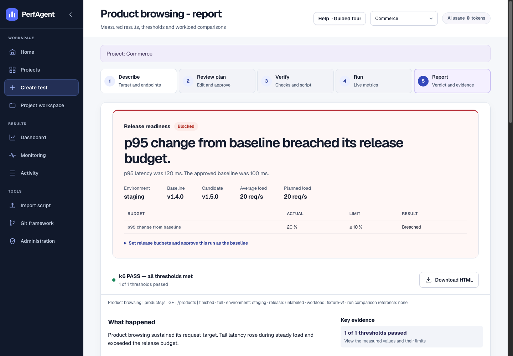

# PerfAgent

Plan, verify, run, and explain HTTP performance tests in one workspace. Start with a URL or API spec, review a proposed workload, and run it with k6. Use the dashboard to track historical results and the report to explain threshold outcomes and release regressions.

[](docs/screenshots/release-report.png)

## Try the demo

From the repository root, with Node 22.12 or later:

```bash
npm --prefix frontend ci
npm --prefix frontend run demo
```

Open <http://127.0.0.1:4174>. Choose **Start tour** or replay it from **Help → Guided tour**. The tour opens each page and points to its controls using a sample checkout project. For a simulated run, open **Commerce Demo → Checkout API**. The demo runs in the browser with sample data.

## Run locally

With Python 3.11+ and uv installed, run:

```bash
uv sync
cp .env.example .env
uv run uvicorn perfagent.api.app:app --reload --host 127.0.0.1 --port 8080
```

Open <http://127.0.0.1:8080> for the bundled UI. Configure a server-side provider key in `.env` for AI drafting and narration. Follow the [local checkout walkthrough](docs/local-setup.md#first-ui-test) to start the sample target and verify your first test.

Review previews requests. Verify sends requests to the target. Start load applies the workload you approved. Use a target you’re authorized to test.

## What you can do

- **Describe and review** an HTTP journey, ramp or steady traffic, response checks, datasets, and captured values.
- **Verify and run** a k6 script, then inspect live throughput, latency, errors, and dropped iterations.
- **Report and compare** saved results, approve a baseline, set release budgets, and export an HTML report.

## Technology

React, TypeScript, and Vite on the frontend. Python, FastAPI, Pydantic, SQLAlchemy, and Alembic on the backend. k6 runs workloads. OpenAI or Anthropic powers AI suggestions through a guarded server-side provider, and LangGraph manages conversation state.

## Documentation

| Guide | What it covers |
| --- | --- |
| [Workflow](docs/workflow.md) | Planning, traffic models, dynamic data, response checks, and reports |
| [Local setup](docs/local-setup.md) | Installation, checkout walkthrough, tests, and troubleshooting |
| [Frontend](frontend/README.md) | Vite development, demo, build, and browser checks |
| [Screenshots](docs/screenshots.md) | Current desktop and mobile workspace views |
| [Architecture and AI roles](docs/architecture.md) | Components, guarded AI, execution boundaries, and managed worker status |
| [Operations](docs/operations.md) | Database, API, observability, and safety |
| [Git and Jenkins](docs/integrations.md) | Saving, importing, and running tests through integrations |
| [Roadmap](docs/roadmap.md) | Remaining implementation and release verification |
