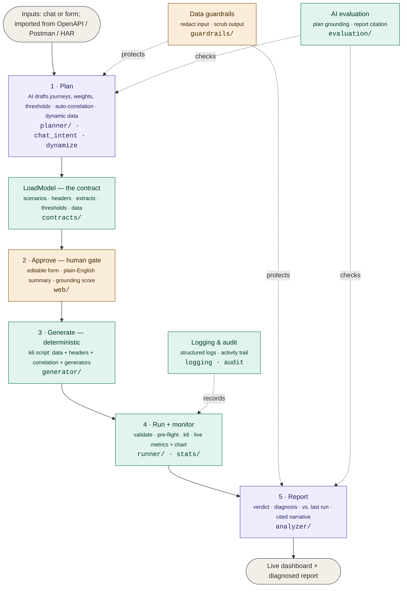

<div align="center">

# ⚡ AI Performance Testing Agent

**Plan, generate, run, and diagnose performance tests from one guided web app —
powered by AI where it helps, deterministic code where it matters.**

Describe your test in plain English (or fill a form) → the AI drafts a realistic plan with
auth flow and dynamic data → you review & approve → the agent generates a k6 script, runs it
with live monitoring, and delivers a diagnosed report that compares against your last run.

</div>

> [!IMPORTANT]
> **Guiding principle — _AI proposes, code proves, humans approve._**
> The AI only *drafts the plan* and *writes the narrative*. Deterministic code owns every
> number, the generated script, and the pass/fail verdict. A human approves before any
> load is fired, and **sensitive data is redacted before it ever reaches the AI.**

---

## Table of contents

- [Why this exists](#why-this-exists)
- [Two ways to build a test](#two-ways-to-build-a-test)
- [The 5-step workflow](#the-5-step-workflow)
- [Feature highlights](#feature-highlights)
- [Dynamic test data — the three sources](#dynamic-test-data--the-three-sources)
- [Quick start](#quick-start)
- [Prerequisites](#prerequisites)
- [Setup](#setup)
- [Running the app](#running-the-app)
- [Running the tests](#running-the-tests)
- [How it works](#how-it-works)
- [Data guardrails](#data-guardrails)
- [AI evaluation](#ai-evaluation)
- [Logging & audit](#logging--audit)
- [Architecture](#architecture)
- [Project layout](#project-layout)
- [Safety notes](#safety-notes)
- [Troubleshooting](#troubleshooting)
- [Roadmap](#roadmap)

---

## Why this exists

Performance testing is slow and expert-bound: deciding *what* to test is tribal
knowledge, writing load scripts (with auth tokens and realistic data) is error-prone, and
reading results is inconsistent. This agent compresses that loop — **minutes instead of
hours** — while keeping humans in control of every decision that matters and keeping the AI
away from anything that must be exact.

| Traditional performance testing | With this agent |
|---|---|
| Hand-pick endpoints & journeys | AI drafts realistic journeys from your endpoints (or an imported spec) |
| Hand-write & maintain scripts | Deterministic generation — the same plan always yields the same script |
| Set up auth/token flow manually | AI auto-detects login → token → reuse (correlation) |
| Hand-wire unique/random request data | AI assigns dynamic generators + your CSV data per field |
| Stare at raw metrics | Plain-English report + automatic bottleneck diagnosis |
| "Is it worse than last time?" — unknown | Automatic **baseline comparison** flags regressions |

---

## Two ways to build a test

Step 1 offers a toggle between two modes:

- **💬 Chat — describe it:** type what you want in plain English ("load test login and
  checkout, 100 users, make each signup email unique"). The AI drafts a plan you review.
- **⚙️ Manual — fill a form:** full control — endpoints, import, data files, headers, test
  type, a body editor with one-click dynamic data, and "run an existing script."

Both produce the same structured plan you review and approve.

---

## The 5-step workflow

```
  1 ─ Describe ──▶ 2 ─ Review & Approve ──▶ 3 ─ Generate ──▶ 4 ─ Run & Monitor ──▶ 5 ─ Report
  chat or form,       editable form,          k6 script         validate, pre-flight,  verdict +
  import a spec       plain-English summary   (deterministic)   live metrics + chart   diagnosis +
                      + grounding + guardrail                                          vs. last run
```

1. **Describe** — chat or form; type/import endpoints (OpenAPI/Swagger/Postman/HAR), add a
   data file, custom headers, and a test type (ramp / spike / soak / stress).
2. **Review & approve** — the AI drafts a plan; edit it in a **form** (weight sliders,
   think-times, thresholds — no JSON), with a plain-English summary of what it does and why.
3. **Generate** — a deterministic renderer produces a runnable **k6** script. No LLM touches it.
4. **Run & monitor** — **validate** the script and **pre-flight** the endpoints, then launch
   k6 with live tiles + chart.
5. **Report** — a **PASS / FAIL / INCONCLUSIVE** verdict, an automatic **diagnosis**, a
   **comparison to your last run**, and an AI narrative whose figures are verified.

---

## Feature highlights

### 🧭 Discover & import
- **OpenAPI / Swagger** (JSON **or YAML**), **Postman collections** (incl. nested folders),
  **HAR captures** — endpoints, sample bodies, and target URL imported automatically.

### 🔐 Real-world auth & data
- **Correlation** — capture a login token / created id from a response (**JSON field,
  header, or cookie**) and reuse it later as `${var}`. Auto-set-up for login flows.
- **Custom headers** — global `Authorization` / API-key headers; values can use captured vars.
- **Dynamic test data** — three sources per field (see below).

### ⏱ Realistic load
- **Test types** — ramp, spike, soak, stress, each a genuinely different load shape.
- **Editable plan form** — scenarios, weights, think-times, thresholds (raw-JSON toggle too).

### ✅ Trust & safety
- **Data guardrails** — secrets/PII/URLs redacted before the AI; output scrubbed.
- **AI evaluation** — plan grounding (no invented endpoints) + report citation (no fabricated numbers).
- **Fail-closed verdict** — an unmeasurable threshold → **INCONCLUSIVE**, never a silent PASS.
- **Logging & audit** — structured logs + an activity log of who-did-what-when.

### 🔎 Run & diagnose
- **Pre-flight check**, **script validation** (`k6 inspect`), **live monitoring + chart**,
  a **diagnosis engine** (bottlenecks, latency tail, concurrency), and **baseline/regression**.

### 🧰 Convenience
- **Run an existing script**, **saved plans** (reopen & re-run), **downloadable HTML report**.

---

## Dynamic test data — the three sources

Real request bodies mix three kinds of values. The agent handles all three, and the
**"✨ Add dynamic data"** button (in the body editor) lets the AI assign the right source to
each field automatically — even in deeply nested bodies.

| Source | When to use | Example | Renders to |
|---|---|---|---|
| **Generator** | A value that must be *unique/random* per request | `${randomEmail}`, `${uuid}`, `${randomInt(1,5)}` | self-contained k6 helpers (`fakeName()`, `uuidv4()`, …) |
| **Data file** | A *real existing* value the API validates | `${branch}` from `branches.csv` | `row.branch` (k6 `SharedArray`) |
| **Fixed** | A constant spec value | `"Weight": 3120`, `"ServiceCode": "GRND"` | kept as-is |

Built-in generators include: `uuid`, `randomEmail`, `randomFullName`, `randomCompanyName`,
`randomStreetAddress`, `randomCity`, `randomState`, `randomZipCode`, `randomPhone`,
`randomCatchPhrase`, `randomBic`, `randomInt(min,max)`, `randomString(n)`,
`randomFrom(a,b,c)`, `dateOffset(n,'days')`, `timestamp`, `sequential`. Postman-style
`{{var}}` / `{{$randomX}}` syntax is also accepted and converted automatically. The
realistic generators emit **self-contained helper functions** — no external faker
dependency, so the script runs on any standard k6.

---

## Quick start

```bash
# 1. install
uv sync

# 2. configure your LLM key
copy .env.example .env        # then edit .env

# 3. run the agent
uv run uvicorn perfagent.api.app:app --reload --port 8080

# 4. (separate terminal) start the safe demo target
uv run python -m perfagent.sample_target.app

# 5. open http://127.0.0.1:8080  →  describe (chat or form) → approve → run
```

---

## Prerequisites

| Requirement | Why | Check | Get it |
|---|---|---|---|
| **Python 3.11+** | The service is Python | `python --version` | <https://www.python.org/downloads/> |
| **uv** *(or pip)* | Dependency manager | `uv --version` | <https://docs.astral.sh/uv/getting-started/installation/> |
| **k6** | Runs & validates the load tests | `k6 version` | <https://grafana.com/docs/k6/latest/set-up/install-k6/> |
| **Git** | Clone / push | `git --version` | <https://git-scm.com/downloads> |
| **LLM API key** | AI planning + narration | — | [OpenAI](https://platform.openai.com/) · [Anthropic](https://console.anthropic.com/) |

> [!NOTE]
> - You **don't** need k6 to plan/generate — only to *run* or *validate*.
> - You **don't** need an API key to run the test suite — the tests mock the LLM.
> - Set a **spend cap** on your provider account before using the AI features.

---

## Setup

<details>
<summary><b>Option A — uv (recommended)</b></summary>

```bash
git clone <your-repo-url>
cd perfagent
uv sync
```
</details>

<details>
<summary><b>Option B — pip + venv</b></summary>

```bash
git clone <your-repo-url>
cd perfagent
python -m venv .venv
.venv\Scripts\activate          # Windows  (source .venv/bin/activate on mac/linux)
pip install -r requirements.txt
```
</details>

Then create your environment file (`copy .env.example .env`) and fill it in:

```ini
LLM_PROVIDER=openai             # or "anthropic"
OPENAI_API_KEY=sk-...
ANTHROPIC_API_KEY=
LOG_LEVEL=INFO
GUARDRAIL_DEBUG=0               # set 1 temporarily to log the (redacted) prompt sent to the AI
```

> `.env` is git-ignored, so your key is never committed.

---

## Running the app

**Terminal 1 — the agent (web UI + API):**
```bash
uv run uvicorn perfagent.api.app:app --reload --port 8080
```
Open **<http://127.0.0.1:8080>**.

**Terminal 2 — the built-in mock target (safe to load-test):**
```bash
uv run python -m perfagent.sample_target.app      # http://127.0.0.1:8000
```

Then: **Describe** (chat or form) → **Draft plan** → review/edit → **Approve** →
**Generate** → **Validate / Pre-flight** → **Run & monitor** → **Report**.

---

## Running the tests

The suite mocks the LLM — **no API key, no paid calls, no k6 required**:

```bash
uv run pytest -q
```

Lint: `uv run ruff check src/ tests/`

---

## How it works

A concrete trace — you draft a plan:

1. Your endpoints (and any pasted collection) post to the API.
2. The API builds a **guarded** LLM provider — the guardrail **redacts** secrets/URLs from
   the *user* prompt before the model sees them (the system prompt is left intact).
3. The planner asks the model for a `LoadModel`, then **deterministic code takes over**: it
   forces the target URL, applies the chosen load profile, collapses duplicate journeys,
   sanity-fixes thresholds, auto-adds the auth header when a token is captured, and
   **restores your real request bodies** (the model only ever saw redacted ones).
4. The API returns the plan + a **grounding score** + the **redaction summary**.
5. You approve → the k6 script is rendered deterministically (data + headers + correlation +
   dynamic generators).
6. You run → k6 launches, the aggregator computes metrics, the browser polls live.
7. On finish → the API computes the **verdict**, **diagnosis**, and **baseline comparison**,
   and the AI writes a **citation-checked** narrative. Every consequential action is audited.

---

## Data guardrails

A guardrail layer wraps **every** LLM call (via the provider interface) — there is no path
to the model that bypasses it. Only the **user** prompt (which carries user data) is
redacted; the fixed system prompt is left intact.

| Category | Handling |
|---|---|
| Emails, passwords, tokens, JWTs, cards (Luhn), SSNs, inline secrets | one-way redaction |
| URL query secrets (`?token=…`) | one-way redaction |
| URL hostnames, internal hosts, private IPs | reversible (restored in reports) |
| `${placeholder}` / `{{var}}` template references | preserved (not treated as secrets) |

Only redaction **counts** are surfaced — never raw values. A standalone
`verify_guardrails.py` script and a `GUARDRAIL_DEBUG=1` mode (logs the *redacted* prompt)
let you confirm nothing sensitive reaches the AI before testing real endpoints.

---

## AI evaluation

- **Plan grounding** — only supplied endpoints are used, weights/think-times valid, within
  guard rails → *"✅ Plan grounded — 6/6 checks passed."*
- **Report citation** — every number in the narrative must trace to a real computed metric;
  fabricated figures are flagged (URLs and timestamps ignored) → *"✅ Report verified."*

---

## Logging & audit

- **Structured logging** (structlog) — readable on the console, JSON in
  `logs/perfagent.log`; records workflow steps and counts, never secrets or bodies.
- **Audit trail** — a durable record of consequential actions (plan created/approved, script
  generated, **run started** with target + peak VUs, **run finished** with verdict),
  surfaced as an **Activity log** in the UI and at `GET /api/audit`.

---

## Architecture



**Trust boundary**

| Owner | Responsible for |
|---|---|
| 🟣 **AI** | Journeys, weights, dynamic-data assignment, the report narrative |
| 🟢 **Code** | Load shape, the generated script, every metric, verdict, diagnosis, baseline |
| 🟡 **Human** | Approving the plan before any load is fired |
| 🟡 **Guardrails** | Redacting sensitive data before the AI sees it |

---

## Project layout

| Path | Responsibility |
|---|---|
| `config.py` | Settings + secrets from `.env` (incl. `log_level`, `guardrail_debug`). |
| `contracts/load_model.py` | Core model: `LoadModel`, `Scenario`, `Step`, `Extract`, `LoadProfile`, `Threshold`, `DataFile`, `headers`. |
| `chat_intent.py` | Chat → structured plan intent (plain-English describe). |
| `dynamize.py` | AI "add dynamic data" — assign generators/CSV columns to a body's fields. |
| `importers/endpoints.py` | Import endpoints from OpenAPI/Swagger (JSON+YAML), Postman, HAR. |
| `guardrails/` | Redaction engine + output scrubbing around every LLM call. |
| `evaluation/` | Plan-grounding and report-citation checks. |
| `providers/` | OpenAI / Anthropic behind one interface (Instructor), wrapped by guardrails. |
| `planner/` | Endpoints → AI-drafted LoadModel; deterministic controls (target, profile, sanity, auto-correlation, real-body restore). |
| `generator/k6_renderer.py` · `k6_data.py` · `k6_corr.py` · `generators.py` · `templates/` | LoadModel → k6 script (data, headers, correlation, dynamic generators). |
| `generator/locust_renderer.py` | Locust renderer (alternative tool). |
| `preflight.py` | One request per endpoint → status report (no load). |
| `runner/k6_runner.py` · `runner/validator.py` | Launch & stream k6; validate a script via `k6 inspect`. |
| `stats/aggregator.py` | Deterministic metric aggregation (percentiles, error rate, RPS). |
| `analyzer/verdict.py` · `diagnostics.py` · `baseline.py` · `narrator.py` · `report.py` | Verdict (fail-closed), diagnosis, regression compare, AI narrative, HTML report. |
| `logging_config.py` · `audit.py` | Structured logging + the audit trail. |
| `db/models.py` | SQLAlchemy models: plans, scripts, data files, run results, audit. |
| `api/app.py` | FastAPI app: REST API + serves the UI. |
| `web/index.html` | The guided wizard UI (chat + manual modes, single file). |
| `sample_target/app.py` | A mock website to test against safely. |

**Tests** cover the schema, generators (incl. realistic + Postman syntax), planner &
profiles & body-restore, runner/stats/validator, analyzer (fail-closed verdict,
diagnostics, baseline), API, guardrails (URL + placeholder), evaluation, data, importers,
headers/pre-flight, correlation (JSON/header/cookie), chat intent, dynamize, and audit.

---

## Safety notes

> [!WARNING]
> **Only run load against systems you own or have explicit written permission to test.**
> Generating load against systems you don't control can cause outages and may be illegal.

- The human approval gate sits **before** any load is fired — always review the plan first.
- Start with low user counts and short durations on any new target, then scale up.
- Sensitive data is redacted before it reaches the LLM; extend detectors in
  `guardrails/redaction.py` for your environment before pointing at production-adjacent data.

---

## Troubleshooting

| Symptom | Fix |
|---|---|
| "k6 is not installed or not on PATH" | Install k6, reopen the terminal, check `k6 version`. |
| "OPENAI_API_KEY is not set" | Fill the key in `.env` and restart the app. |
| Run shows 0 requests / "Run error" | The target isn't running, or the URL is wrong. Start the target and retry. |
| Chat asks clarifying questions | Expected — add the answers to your description and draft again, or use Manual mode. |
| Imported a spec but no endpoints | Confirm it's valid OpenAPI (JSON/YAML), a Postman collection, or a `.har`. |
| `/me` (or a protected call) is 401 in pre-flight | Expected — pre-flight hits endpoints alone; correlation flows the token only in a full run. |
| `table ... already exists` on startup | Delete the SQLite DB once (new tables were added) and restart. |
| Tests fail on import | Run `uv sync` again; make sure you're in the project `.venv`. |

---

## Roadmap

**✅ Working today**
Chat or form input · import (OpenAPI/Swagger JSON+YAML, Postman, HAR) · AI planning with an
editable form & plain-English summary · guardrails (+ verify script & debug mode) · AI
evaluation · correlation (JSON/header/cookie, auto-set-up) · **dynamic data (generators +
CSV + AI "add dynamic data", Postman `{{var}}` syntax)** · custom headers · test types
(ramp/spike/soak/stress) · pre-flight · script validation · live monitoring + chart ·
diagnosis engine · fail-closed verdict · baseline/regression · run-an-existing-script ·
logging & audit · cited reports.

**🔭 Planned next**
- **Conversational chat** — a true back-and-forth chat interface (replacing the single-shot describe).
- **Autonomy & reach** — MCP server interface (Cursor / Claude Code / CI); scheduled & CI-triggered runs; LangGraph orchestration.
- **More tools** — JMeter / Gatling runners; regex extraction.
- **Hosting / enterprise** — durable run state (Postgres + job queue), load workers,
  auth & RBAC, target allow-list & safety rails, multi-tenancy, WebSockets, observability.

---

<div align="center">
<sub>Built with FastAPI · k6 · Pydantic · Instructor · OpenAI / Anthropic · SQLAlchemy · structlog</sub>
</div>