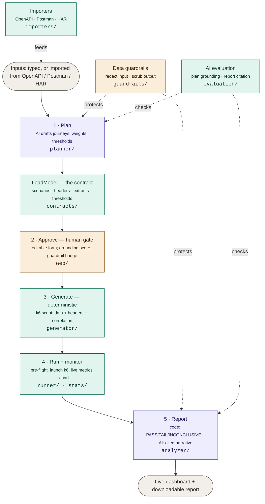

# AI Performance Testing Agent

An AI agent that **plans, generates, runs, and reports on performance tests** — from a
guided web UI. You describe (or import) a target and its endpoints; the agent drafts a
test plan, you review and approve it, and the agent generates a runnable load-test
script, runs it with live monitoring, and produces a stakeholder-ready report.

> **Guiding principle:** the AI *drafts and narrates*; deterministic code *owns every
> number and the pass/fail verdict*; a *human approves* before any load is fired.
> Sensitive data is *redacted before it ever reaches the AI*.

---

## Table of contents

- [What it does](#what-it-does)
- [Prerequisites](#prerequisites)
- [Setup](#setup)
- [Running the app](#running-the-app)
- [Running the tests](#running-the-tests)
- [Key features](#key-features)
- [Data guardrails](#data-guardrails)
- [AI evaluation](#ai-evaluation)
- [Architecture](#architecture)
- [Every file explained](#every-file-explained)
- [Safety notes](#safety-notes)
- [Troubleshooting](#troubleshooting)
- [Roadmap](#roadmap)

---

## What it does

A guided 5-step workflow in one browser app:

1. **Describe** — enter a target + endpoints, **or import them** from an OpenAPI/Swagger
   spec, a Postman collection, or a HAR capture. Optionally upload a test-data file and
   add custom headers.
2. **Review & approve** — the AI drafts a structured plan (a *LoadModel*). You edit it in
   a **form** (scenarios, weight sliders, think-times, thresholds — no raw JSON needed)
   and approve. A grounding score and a guardrail badge show the plan is safe and sound.
3. **Generate** — a deterministic renderer turns the plan into a runnable **k6** script
   (Locust also supported). No LLM touches the script.
4. **Run + monitor** — the agent launches k6 and streams live metrics into the browser
   (requests, RPS, error rate, p95/p99, a live chart, per-endpoint breakdown). A
   **pre-flight check** can verify every endpoint responds before a full run.
5. **Report** — a deterministic **PASS / FAIL / INCONCLUSIVE** verdict, plus an AI-written
   plain-English summary whose figures are verified against the real metrics.

Everything that matters — the load shape, every metric, the verdict — is computed by
code. The AI is involved only in drafting the plan and writing the report narrative.

---

## Prerequisites

| Requirement | Why | How to check | Where to get it |
|---|---|---|---|
| **Python 3.11+** | The whole service is Python | `python --version` | https://www.python.org/downloads/ |
| **uv** *(or plain pip)* | Installs dependencies | `uv --version` | https://docs.astral.sh/uv/getting-started/installation/ |
| **k6** | Runs the load tests (only for the Run step) | `k6 version` | https://grafana.com/docs/k6/latest/set-up/install-k6/ |
| **Git** | Clone / push the repo | `git --version` | https://git-scm.com/downloads |
| **An LLM API key** | AI planning + report narration | — | OpenAI: https://platform.openai.com/ · Anthropic: https://console.anthropic.com/ |

Notes:
- You do **not** need k6 to plan/generate — only to actually *run*.
- You do **not** need an API key to run the test suite — the tests mock the LLM.
- Set a **spend cap** on your provider account before using the AI features.

---

## Setup

### Option A — uv (recommended)

    git clone <your-repo-url>
    cd perfagent
    uv sync

### Option B — pip + venv

    git clone <your-repo-url>
    cd perfagent
    python -m venv .venv
    .venv\Scripts\activate         # Windows   (source .venv/bin/activate on mac/linux)
    pip install -r requirements.txt

### Then (both) — env file

    copy .env.example .env         # Windows   (cp on mac/linux)

Edit `.env`:

    LLM_PROVIDER=openai            # or "anthropic"
    OPENAI_API_KEY=sk-...
    ANTHROPIC_API_KEY=

---

## Running the app

**Terminal 1 — the agent:**

    uv run uvicorn perfagent.api.app:app --reload --port 8080

Open **http://127.0.0.1:8080**.

**Terminal 2 — the built-in mock target (safe demo):**

    uv run python -m perfagent.sample_target.app     # http://127.0.0.1:8000

Then in the browser: Describe (or import) → Draft plan with AI → review/edit → Approve →
Generate → Run & monitor → Report.

---

## Running the tests

The suite mocks the LLM, so it needs **no API key**:

    uv run pytest -q

Lint:

    uv run ruff check src/ tests/

---

## Key features

**Endpoint import** — point the tool at what you already have instead of typing endpoints:
- **OpenAPI / Swagger** (JSON): all paths + methods, sample bodies from the request schema, target URL inferred.
- **Postman collection**: requests (incl. nested folders) with raw bodies.
- **HAR capture**: the real requests from a recorded session (static assets and duplicates filtered out).

**Correlation** — flow a value from one response into later requests, the heart of real
authenticated testing. A step can **extract** a value (e.g. a login token, an order id)
from its JSON response into a variable; later steps reference it as `${var}` in a path,
body, or header. The generated k6 captures it (`vars.token = res.json("token")`) and
reuses it (`Authorization: Bearer ${vars.token}`).

**Custom headers** — global headers (e.g. `Authorization`, API keys) applied to every
request. Header values may reference captured variables (`Bearer ${token}`). Header
values go to the runner, never the LLM.

**Data-file parameterization** — upload a CSV/TSV/TXT/JSON/JSONL file; each virtual user
picks a row, so `${column}` placeholders in paths/bodies vary per user.

**Pre-flight check** — fire one request per endpoint and show the status codes before a
full run, so bad data/auth is caught early.

**Editable plan form** — scenarios as cards with weight sliders, steps and thresholds as
editable rows; a raw-JSON toggle for advanced edits.

**Live monitoring** — real-time tiles (RPS, error rate, p95/p99) plus a live chart.

**Fail-closed verdict** — if a threshold can't be evaluated (unknown or missing metric),
the verdict is **INCONCLUSIVE**, never a silent PASS.

---

## Data guardrails

A guardrail layer wraps **every** LLM call (wired into the provider interface), so both
the planner and the reporter are covered. Sensitive data is handled before any prompt is
sent and the response is scrubbed on the way back.

| Category | Handling |
|---|---|
| Emails, passwords, tokens, JWTs, cards (Luhn), SSNs, inline secrets | one-way redaction |
| URL query secrets (`?token=…`) | one-way redaction |
| URL hostnames, internal hosts, private IPs | reversible (restored in reports) |
| `${placeholder}` template references | preserved (not treated as secrets) |

Only redaction **counts** are ever surfaced or logged — never the raw values. After
drafting, the UI shows e.g. *"🛡 2 sensitive values redacted before sending to the AI."*

---

## AI evaluation

Guardrails protect what goes *into* the AI; the evaluation harness verifies what comes
*out* — deterministically, against ground truth:

- **Plan grounding** — the drafted plan uses only supplied endpoints (no invention),
  valid weights/think-times, and stays within the requested guard rails. Shown as a
  score (e.g. *"✅ Plan grounded — 6/6 checks passed"*).
- **Report citation** — every number in the AI narrative must trace to a real computed
  metric; fabricated figures are flagged (*"✅ Report verified — all N figures trace to
  real metrics"*).

---

## Architecture

The system is a pipeline connected by a shared contract (the `LoadModel`). The AI is
involved only in drafting the plan and writing the report narrative; everything else is
deterministic code, and a human approves before any load is fired.

**Trust boundary:** AI drafts the plan and writes the report narrative; code owns the
load shape, the generated script, every metric, and the verdict; a human approves before
load fires and the guardrails redact sensitive data before the AI sees it.

---

## Every file explained

### `src/perfagent/`
| Path | Responsibility |
|---|---|
| `config.py` | Settings + secrets from `.env` (pydantic-settings). |
| `contracts/load_model.py` | The core model: `LoadModel`, `Scenario`, `Step` (+ `Extract` for correlation), `LoadProfile`, `Threshold`, `DataFile`, `headers`. |
| `contracts/artifacts.py` | Plan/Script artifacts with lineage. |
| `importers/endpoints.py` | Import endpoints from OpenAPI/Swagger, Postman, HAR. |
| `providers/` | OpenAI / Anthropic behind one interface (Instructor), wrapped by the guardrails. |
| `guardrails/` | Redaction engine + output scrubbing around every LLM call. |
| `evaluation/` | Plan-grounding and report-citation checks. |
| `planner/` | Endpoints → AI-drafted LoadModel (+ deterministic load-profile shape). |
| `generator/k6_renderer.py` | LoadModel → k6 script (data, headers, correlation). |
| `generator/k6_data.py` | Data-file loading + `${field}` substitution. |
| `generator/k6_corr.py` | Correlation: capture code + `vars.*` / `row.*` reference resolution. |
| `generator/templates/k6.js.j2` | The k6 script template. |
| `generator/locust_renderer.py` | Locust renderer (alternative tool). |
| `preflight.py` | One request per endpoint → status report (no load). |
| `runner/k6_runner.py` | Launches k6, streams metrics, writes the data file next to the script. |
| `stats/aggregator.py` | Deterministic metric aggregation (percentiles, error rate, RPS). |
| `analyzer/verdict.py` | Deterministic PASS/FAIL/INCONCLUSIVE (fail-closed). |
| `analyzer/narrator.py` | AI narrative over the computed numbers (with a no-LLM fallback). |
| `analyzer/report.py` | Self-contained HTML report. |
| `db/models.py` | SQLAlchemy models: plans, scripts, data files. |
| `api/app.py` | FastAPI app: the REST API + serves the UI. |
| `web/index.html` | The guided wizard UI (one file). |
| `sample_target/app.py` | A mock website to test against safely. |

### `tests/`
Schema, generators (k6/Locust), planner, profile, runner/stats, analyzer (incl.
fail-closed), API, guardrails (incl. URL + placeholder), evaluation, data, importers,
headers + pre-flight, and correlation.

---

## Safety notes

- **Only run load against systems you own or have explicit permission to test.**
- The human approval gate sits *before* any load is fired — review the plan first.
- Start with low user counts and short durations on any new target.
- Sensitive data is redacted before reaching the LLM; extend the detectors in
  `guardrails/redaction.py` for your environment before pointing at production-adjacent data.

---

## Troubleshooting

| Symptom | Fix |
|---|---|
| "k6 is not installed or not on PATH" | Install k6, reopen the terminal, check `k6 version`. |
| "OPENAI_API_KEY is not set" | Fill the key in `.env` and restart. |
| Run shows 0 requests / "Run error" | The target isn't running, or the URL is wrong. Start the target and retry. |
| Imported a spec but no endpoints | Only JSON OpenAPI is supported (convert YAML to JSON); confirm it's a valid spec/collection/HAR. |
| Generated script won't run in k6 | Regenerate it; ensure it saved as UTF-8. |
| Tests fail on import | `uv sync` again; make sure you're in the project `.venv`. |

---

## Roadmap

**Working today:** import (OpenAPI/Postman/HAR), AI planning with an editable form,
guardrails, evaluation, data parameterization, custom headers, correlation, pre-flight,
live monitoring + chart, fail-closed verdict, cited reports.

**Planned next:**
- Correlation UI (define extractions by clicking, not JSON)
- YAML OpenAPI import; header/regex extraction
- Baseline comparison / regression across runs
- WebSockets for live monitoring; async queue for concurrent runs
- Enterprise hardening: target allow-list, server-enforced approval, sandboxed runner,
  durable run state (Postgres + queue), auth/RBAC, CI/CD integration

---

## Design documents

See the `docs/` folder for the architecture, approach, reference-repo teardown, and
tech-stack decisions.