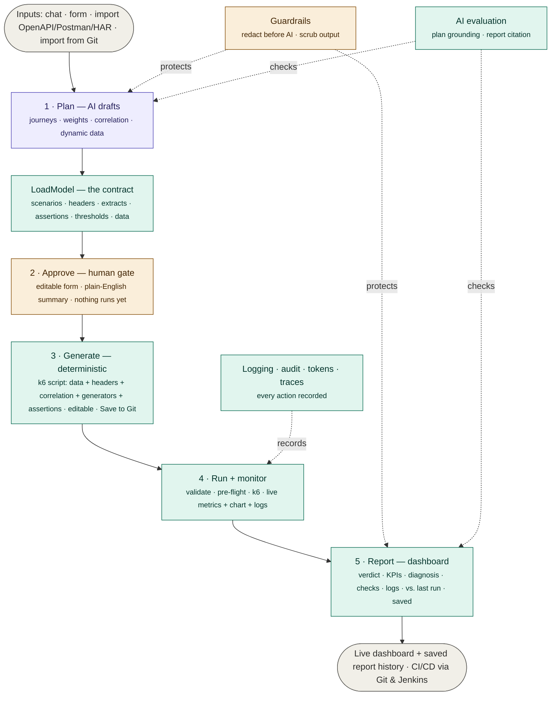

<div align="center">

# ⚡ AI Performance Testing Agent

**Plan, generate, run, and diagnose performance tests from one guided web app —
powered by AI where it helps, deterministic code where it matters.**

Describe your test in plain English (or fill a form, or import a spec) → the AI drafts a
realistic plan with auth flow and dynamic data → you review & approve → the agent generates
a k6 script, runs it with live monitoring, and delivers a **report dashboard** that compares
against your last run and is saved to a browsable history.

</div>

> [!IMPORTANT]
> **Guiding principle — _AI proposes, code proves, humans approve._**
> The AI only *drafts the plan* and *writes the narrative*. Deterministic code owns every
> number, the generated script, and the pass/fail verdict. A human approves before any load
> is fired, and **sensitive data is redacted before it ever reaches the AI.**

---

## Table of contents

- [Why this exists](#why-this-exists)
- [Two ways to build a test](#two-ways-to-build-a-test)
- [The 5-step workflow](#the-5-step-workflow)
- [Feature highlights](#feature-highlights)
- [Dynamic test data — the three sources](#dynamic-test-data--the-three-sources)
- [Validating the response — assertions & suggested checks](#validating-the-response--assertions--suggested-checks)
- [Quick start](#quick-start)
- [Prerequisites](#prerequisites)
- [Setup](#setup)
- [Running the app](#running-the-app)
- [Save tests to Git and import them back](#save-tests-to-git-and-import-them-back)
- [Run in Jenkins](#run-in-jenkins-step-3)
- [Running the tests](#running-the-tests)
- [How it works](#how-it-works)
- [Data guardrails](#data-guardrails)
- [AI evaluation](#ai-evaluation)
- [Observability — logging, audit & tokens](#observability--logging-audit--tokens)
- [Architecture](#architecture)
- [Project layout](#project-layout)
- [Safety notes](#safety-notes)
- [Troubleshooting](#troubleshooting)
- [Roadmap](#roadmap)

---

## Why this exists

Performance testing is slow and expert-bound: deciding *what* to test is tribal knowledge,
writing load scripts (with auth tokens and realistic data) is error-prone, and reading
results is inconsistent. This agent compresses that loop — **minutes instead of hours** —
while keeping humans in control of every decision that matters and keeping the AI away from
anything that must be exact.

| Traditional performance testing | With this agent |
|---|---|
| Hand-pick endpoints & journeys | AI drafts realistic journeys from your endpoints (or an imported spec) |
| Hand-write & maintain scripts | Deterministic generation — the same plan always yields the same script |
| Set up auth/token flow manually | AI auto-detects login → token → reuse (correlation) |
| Hand-wire unique/random request data | AI assigns dynamic generators + your CSV data per field |
| Stare at raw metrics | A report dashboard + automatic bottleneck diagnosis |
| "Is it worse than last time?" — unknown | Automatic **baseline comparison** flags regressions |
| Reports lost after the run | Every run's report is **saved** and reopenable |
| Status-code-only checks | **Assertions** validate the response body, not just 2xx |
| No visibility into why a check failed | A **response-checks panel** + live/saved **run logs** show exactly what failed |
| One load tool | Generate for **k6, Locust, JMeter, Gatling** from one plan |
| Scripts stuck in the tool | **Save to Git** as a CI-ready framework; **run in Jenkins** and follow it live |

---

## Two ways to build a test

Step 1 offers a toggle between two modes:

- **💬 Chat — describe it:** type what you want in plain English ("load test login and
  checkout, 100 users, make each signup email unique"). The AI drafts a plan you review.
- **⚙️ Manual — fill a form:** full control — endpoints, import, data files, headers, test
  type, environment, a body editor with one-click **dynamic data**, and "run an existing script."

Both produce the same structured plan you review and approve. Inline **ℹ️ tooltips** explain
every concept, so a QA engineer can use it without a walkthrough.

---

## The 5-step workflow

```
  1 ─ Describe ──▶ 2 ─ Review & Approve ──▶ 3 ─ Generate ──▶ 4 ─ Run & Monitor ──▶ 5 ─ Report
  chat or form,       editable form,          k6 script         validate, pre-flight,  dashboard +
  import a spec       plain-English summary   (deterministic,   live metrics, chart,   diagnosis +
                      + grounding + guardrail  editable)         live logs              vs. last run,
                                                                                        checks + logs (saved)
```

1. **Describe** — chat or form; type/import endpoints, add a data file, custom headers, test type, environment.
2. **Review & approve** — edit the plan in a form (weight sliders, think-times, thresholds, **response checks**), with a plain-English summary of what it does and why.
3. **Generate** — a deterministic renderer produces a runnable **k6** script. No LLM touches it. You can **edit it** to add custom debugging before running, and **Save to Git** for CI/CD.
4. **Run & monitor** — **validate** the script and **pre-flight** the endpoints, then launch k6 with live tiles, a chart, and **live run logs**.
5. **Report** — a **dashboard**: PASS/FAIL/INCONCLUSIVE verdict, KPI tiles, automatic **diagnosis**, a **comparison to your last run**, a **response-checks panel**, the **run logs**, and an AI narrative whose figures are verified. Saved to the **Runs & reports** history so you can reopen it anytime.

---

## Feature highlights

### 🧭 Discover & import
- **OpenAPI / Swagger** (JSON **or YAML**), **Postman collections** (incl. nested folders),
  **HAR captures** — endpoints, sample bodies, and target URL imported automatically.
- **Import from Git** — pull a test PerfAgent previously saved back as an editable plan, or
  pick up another k6 script from a repository.

### 🔐 Real-world auth & data
- **Correlation** — capture a value from a response (**JSON field, header, cookie, or
  regex**, incl. array indices like `data[0].id`) and reuse it later as `${var}`. Auto-set-up for login flows.
- **Assertions** — validate the response, not just the status: body **contains** / **does NOT
  contain** text, **status code is** N, a **JSON field compares** (eq/ne/gt/lt/contains), or
  **response time under** N ms. A failed assertion counts as an error and fails the run.
- **✨ Suggest checks from a response** — paste a real API response and the AI proposes the
  right checks (which elements must be present, which errors to guard against, which numbers
  should be positive); the response is redacted before it's sent, and you keep only the checks you want.
- **Custom headers** — global `Authorization` / API-key headers; values can use captured vars.
- **Dynamic test data** — three sources per field (see below), assigned by the AI with one click.

### ⏱ Realistic load
- **Test types** — ramp, spike, soak, stress, each a genuinely different load shape.
- **Environment & TLS** — tag a run with an environment name (dev/staging/prod), and for test
  or dev hosts optionally **skip TLS certificate verification** (never against production).
- **Protocols** — REST/HTTP and **GraphQL** (a step can send a `{query, variables}` request).
- **Multi-tool** — generate scripts for **k6** (primary, with a live runner), **Locust**,
  **JMeter** (`.jmx`), and **Gatling** (`.scala`) from the same plan.
- **Editable plan form** — scenarios, weights, think-times, thresholds (raw-JSON toggle too).

### ✅ Trust & safety
- **Data guardrails** — secrets/PII/URLs redacted before the AI; output scrubbed.
- **AI evaluation** — plan grounding (no invented endpoints) + report citation (no fabricated numbers).
- **Fail-closed verdict** — an unmeasurable threshold → **INCONCLUSIVE**, never a silent PASS.

### 🔎 Run & diagnose
- **Pre-flight check**, **script validation** (`k6 inspect`), **live monitoring + chart**,
  **live run logs** (k6's output streamed as it runs — threshold crossings, the checks
  summary, and your script's own `console.*` messages), a **diagnosis engine** (bottlenecks,
  latency tail, concurrency), and **baseline/regression**.
- **Editable script** — tweak the generated k6 before running (e.g. add custom `console.log`
  debugging, or your own validation); **Regenerate** restores the deterministic version.

### 📊 Report & history
- **Report dashboard** — verdict hero, KPI tiles, diagnosis + baseline cards, executive summary.
- **Response checks panel** — each assertion with its pass/fail count, so you can see exactly
  which checks failed and why the run passed or failed.
- **Run logs** — the full k6 output for the run is shown on the report, **saved with it**, and
  **downloadable as a `.txt`** — reopen a run from history and its logs are still there.
- **Time-series + trend charts** — latency/RPS/errors over the run, and p95/error trends across recent runs.
- **SLA profiles** — save reusable threshold sets (e.g. "p95<300ms, errors<1%") and apply to any plan.
- **Runs & reports history** — every finished run saved; click to reopen its full report.
- **Downloadable HTML report** for stakeholders.

### 🚀 Ship to CI/CD
- **Save to Git** — export the test into a named k6 framework with ready-made **GitHub
  Actions, Jenkins, Azure DevOps and GitLab** pipelines; secrets are never committed.
- **Run in Jenkins** — trigger the pipeline for a saved test and follow it live in PerfAgent
  (queued → running → finished, console log streaming, archived k6 results and verdict).

### 🧰 Convenience
- **Run an existing script**, **saved plans** (reopen & re-run), **token-usage** visibility,
  and **saved (non-secret) Git/Jenkins details** so you don't retype them.

---

## Dynamic test data — the three sources

Real request bodies mix three kinds of values. The agent handles all three, and the
**"✨ Add dynamic data"** button (in the body editor) lets the AI assign the right source to
each field automatically — even in deeply nested bodies.

| Source | When to use | Example | Renders to |
|---|---|---|---|
| **Generator** | A value that must be *unique/random* per request | `${randomEmail}`, `${uuid}`, `${randomInt(1,5)}` | self-contained k6 helpers (`fakeName()`, `uuidv4()`, …) |
| **Data file** | A *real existing* value the API validates | `${branch}` from `branches.csv` | `row.branch` (k6 `SharedArray`) |
| **Fixed** | A constant spec value | `"Weight": 3120`, `"ServiceCode": "GRND"` | kept as-is |

Built-in generators include: `uuid`, `randomEmail`, `randomFullName`, `randomCompanyName`,
`randomStreetAddress`, `randomCity`, `randomState`, `randomZipCode`, `randomPhone`,
`randomCatchPhrase`, `randomBic`, `randomInt(min,max)`, `randomString(n)`,
`randomFrom(a,b,c)`, `dateOffset(n,'days')`, `timestamp`, `sequential`. Postman-style
`{{var}}` / `{{$randomX}}` syntax is also accepted and converted automatically. The realistic
generators emit **self-contained helper functions** — no external faker dependency, so the
script runs on any standard k6.

---

## Validating the response — assertions & suggested checks

A load test that only checks the HTTP status can **pass while the API is returning errors** —
many APIs answer `200 OK` with an error payload in the body. Assertions close that gap.

**Assertion kinds** (added per step, in plain English):

| Check | Passes when | Example |
|---|---|---|
| **Response body contains** | the body includes the text | contains `<Rate>` |
| **Response body does NOT contain** | the body is free of the text | does NOT contain `Invalid Parameters` |
| **Status code is** | the status equals N | status is `200` |
| **JSON field compares** | a field eq/ne/gt/lt/contains a value | `data.total` **gt** `0` |
| **Response time under (ms)** | the request finished in time | under `2000` ms |

A failed assertion is counted as an **error** (not just a failed k6 check), so it raises the
error rate and can **fail the run** — assertions are enforced, not decorative. The
**response-checks panel** on the report shows each check's pass/fail count.

**✨ Suggest checks from a response** — rather than hand-writing every check, paste a **real
response** you captured (from Postman or curl) and the AI proposes a layered set: the
structural elements that should always be present, the error strings to guard against, and
the numeric fields that should be positive. You review the list and keep what you want. The
pasted response is **redacted** (secrets/PII removed) before it is sent to the AI — only the
structure is shared.

---

## Quick start

```bash
# 1. install
uv sync

# 2. configure your LLM key
copy .env.example .env        # then edit .env

# 3. run the agent
uv run uvicorn perfagent.api.app:app --reload --port 8080

# 4. (separate terminal) start the safe demo target
uv run python -m perfagent.sample_target.app

# 5. open http://127.0.0.1:8080  →  describe (chat or form) → approve → run
```

---

## Prerequisites

| Requirement | Why | Check | Get it |
|---|---|---|---|
| **Python 3.11+** | The service is Python | `python --version` | <https://www.python.org/downloads/> |
| **uv** *(or pip)* | Dependency manager | `uv --version` | <https://docs.astral.sh/uv/getting-started/installation/> |
| **k6** *(optional)* | Runs & validates the load tests — **downloaded automatically** on first run if missing | `k6 version` | Not needed; see *k6 is installed automatically* below |
| **Git 2.31+** | Clone / push, and Save to Git / Import from Git | `git --version` | <https://git-scm.com/downloads> |
| **LLM API key** | AI planning + narration | — | [OpenAI](https://platform.openai.com/) · [Anthropic](https://console.anthropic.com/) |

> [!NOTE]
> - You **don't** need to install k6. On the first run or validation PerfAgent downloads the pinned, checksum-verified k6 into `~/.perfagent/bin/` (see below).
> - You **don't** need an API key to run the test suite — the tests mock the LLM.
> - Set a **spend cap** on your provider account before using the AI features.

---

## Setup

<details>
<summary><b>Option A — uv (recommended)</b></summary>

```bash
git clone https://github.com/karthikrasamsetti/perfagent.git
cd perfagent
uv sync
```
</details>

<details>
<summary><b>Option B — pip + venv</b></summary>

```bash
git clone https://github.com/karthikrasamsetti/perfagent.git
cd perfagent
python -m venv .venv
.venv\Scripts\activate          # Windows  (source .venv/bin/activate on mac/linux)
pip install -r requirements.txt
```
</details>

Then create your environment file (`copy .env.example .env`) and fill it in:

```ini
LLM_PROVIDER=openai             # or "anthropic"
OPENAI_API_KEY=sk-...
ANTHROPIC_API_KEY=
LOG_LEVEL=INFO
GUARDRAIL_DEBUG=0               # set 1 temporarily to log the (redacted) prompt sent to the AI
```

> `.env` is git-ignored, so your key is never committed.

---

## Running the app

**Terminal 1 — the agent (web UI + API):**
```bash
uv run uvicorn perfagent.api.app:app --reload --port 8080
```
Open **<http://127.0.0.1:8080>**.

**Terminal 2 — the built-in mock target (safe to load-test):**
```bash
uv run python -m perfagent.sample_target.app      # http://127.0.0.1:8000
```

Then: **Describe** (chat or form) → **Draft plan** → review/edit → **Approve** →
**Generate** → **Validate / Pre-flight** → **Run & monitor** → **Report**.

---

### k6 is installed automatically

PerfAgent looks for k6 in this order and uses the first one it finds:

1. `PERFAGENT_K6_PATH` — an explicit path to a k6 binary.
2. A bundled copy at `src/perfagent/runner/bin/<os>-<arch>/k6` (`k6.exe` on Windows), e.g. `windows-amd64`, `linux-amd64`, `macos-arm64`.
3. The cache at `~/.perfagent/bin/k6-v1.3.0/` (change the base folder with `PERFAGENT_HOME`).
4. A `k6` already on `PATH`.
5. Otherwise it downloads the official k6 v1.3.0 for this OS from GitHub, verifies its SHA-256
   against a hash pinned in `runner/k6_binary.py`, and stores it in the cache (step 3).

The first run shows "Setting up the load engine (first run only)…" while this happens. For machines
without internet access, use option 1 or 2. In Docker, install k6 in the image and set
`PERFAGENT_K6_PATH` so nothing is downloaded at runtime.

> [!NOTE]
> k6 prints Unicode (box-drawing and ✓/✗ characters) in its summary. PerfAgent decodes k6's
> output as UTF-8 so the **run logs** render those characters correctly on every platform,
> including Windows.

## Save tests to Git and import them back

### Save to Git (Step 3)

After generating a k6 script, the **Save to Git for CI/CD** card exports it into a named
framework and pushes it. Enter a framework name, a test name, the repository URL, branch
and an access token with push rights (not needed for SSH URLs). The token is used for that
push only and is never stored; no user name is needed. The exported script is built by the
**same deterministic generator** used in the app, so it carries your assertions, correlation,
dynamic data, GraphQL and TLS settings — with secret header values swapped for CI-provided
environment variables.

```
<framework>/
  tests/<test>/loadtest.js · plan.json · test.json
  environments/dev.env          BASE_URL (copy for uat.env, staging.env, …)
  scripts/run-tests.sh · .ps1   run one test or all
  ci/Jenkinsfile · azure-pipelines.yml · gitlab-ci.yml
  README.md · perfagent.json
.github/workflows/perf-<framework>.yml
```

* Pushing into an existing repository only **adds** files; nothing else is touched.
  PerfAgent refuses to write into a folder it didn't create, so pick a new framework name.
* Secret header values are never committed: the script reads `PERF_HEADER_<NAME>` from the
  environment and stops if one is missing. Add them as CI secrets.
* Test data is only committed if you tick the box. A final scan aborts the push if any secret
  value ended up in a file.
* Thresholds are enforced by k6, so a breach exits with code 99 and fails the pipeline.
* Exporting again with the same names updates the test in a new commit.
* **Download framework (.zip)** gives the same files without Git.
* Uploaded scripts ("Already have a k6 script?") can't be saved to Git yet.

### Import from Git (Step 1)

**Import an existing test from Git** lists what's on a branch:

* **Tests PerfAgent saved** — *Import* loads one back as an editable plan (Step 2), asking
  again for its secrets; committed test data comes along. Tests whose `loadtest.js` was
  edited by hand are flagged, because PerfAgent rebuilds scripts from the plan.
* **Other load-test scripts** (k6, Locust, JMeter) — *View* shows them; a k6 script can be
  loaded with *Use this script*, exactly like "Already have a k6 script?".

Every push and import is recorded in the activity log. The server needs `git` 2.31+.
Admins can set `GIT_ALLOWED_HOSTS`, `GIT_AUTHOR_NAME` and `GIT_AUTHOR_EMAIL` in `.env`.

API: `POST /api/scripts/{id}/export/git`, `POST /api/scripts/{id}/export/zip`,
`GET /api/export/settings`, `POST /api/git/scan`, `POST /api/git/import`, `POST /api/git/script`.

## Run in Jenkins (Step 3)

The **Run in Jenkins** card triggers the Jenkins pipeline for a test you saved to Git and
follows it in PerfAgent: queued → running → finished, with the console log streaming in, a
link to the build, and — when it finishes — the k6 results the Jenkinsfile archived
(requests, req/sec, error rate, avg / p95 / max, each threshold, and a PASS / FAIL verdict).
**Stop** aborts the build.

Enter the Jenkins URL, your Jenkins user name, an **API token** (Jenkins → your name →
Security → API Token), the job name (`folder/job` for folders), the test (or `all`) and the
environment. The token is sent with each call and never stored.

**Set up Jenkins job** creates the Pipeline job — or updates it if it exists — pointing at
`<framework>/ci/Jenkinsfile` in your repository, with the `TEST` and `PERF_ENV` parameters
declared, so no manual first build is needed (needs the *Job/Create* permission; give a Git
credentials ID for private repositories). If you create the job by hand instead, run it once
in Jenkins so it learns its parameters.

Jenkins side: Pipeline + Git plugins; a Linux/macOS agent with `curl`, `sha256sum` and `tar`, or a
Windows agent with PowerShell (the Jenkinsfile picks the right one and downloads k6 once per
workspace, verifying its checksum); and a
*Secret text* credential for each secret the test needs (e.g. `PERF_HEADER_AUTHORIZATION`).
PerfAgent must be able to reach Jenkins, and Jenkins must reach Git and the application.
Admins can restrict which Jenkins servers may be called with `JENKINS_ALLOWED_HOSTS`.

API: `POST /api/jenkins/trigger`, `/api/jenkins/status`, `/api/jenkins/stop`, `/api/jenkins/setup-job`.

### Saved Git and Jenkins details

PerfAgent remembers the **non-secret** details you used, per plan, so you don't retype them:
the Git repository, branch, framework, test and pipelines; the Jenkins URL, user name, job,
test and environment, and the job set-up details (repository, branch, framework, Git
credentials ID). They are saved only after something **succeeds** — a push, an import, a
Jenkins run or job set-up — and filled in when you open the plan again from *Saved plans*.
A brand-new plan starts with the last-used repository, branch, Jenkins URL, user name,
Git credentials ID and environment.

**Never saved:** Git tokens, Jenkins API tokens and test secrets — you enter those each time.
URLs that contain credentials are refused. *Forget saved details* on each card removes them
(for that plan and from the last-used defaults). They live in the `integration_settings`
table, which is added automatically to existing databases.

API: `GET /api/integrations?plan_id=…`, `DELETE /api/integrations?plan_id=…&section=git|jenkins|all`.

## Running the tests

The suite mocks the LLM — **no API key, no paid calls, no k6 required**:

```bash
uv run pytest -q
```

For a faster local run, execute the suite in parallel (the Git/Jenkins tests shell out to
real `git`, which is slower on Windows):

```bash
uv run pytest -q -n auto            # needs pytest-xdist
uv run pytest -q -k "not git"       # skip the slow Git integration tests
```

A few tests exercise POSIX-only behaviour (symlinks, `sh`) and are **skipped on Windows**;
they run in full on Linux/macOS CI.

Lint: `uv run ruff check src/ tests/`

---

## How it works

A concrete trace — you draft a plan:

1. Your endpoints (and any pasted collection) post to the API.
2. The API builds a **guarded** LLM provider — the guardrail **redacts** secrets/URLs from
   the *user* prompt before the model sees them (the system prompt is left intact).
3. The planner asks the model for a `LoadModel`, then **deterministic code takes over**: it
   forces the target URL, applies the chosen load profile, collapses duplicate journeys,
   sanity-fixes thresholds, auto-adds the auth header when a token is captured, and
   **restores your real request bodies** (the model only ever saw redacted ones).
4. The API returns the plan + a **grounding score** + the **redaction summary** + token usage.
5. You approve → the k6 script is rendered deterministically (data + headers + correlation +
   dynamic generators + assertions + TLS). You can edit it before running.
6. You run → k6 launches, the aggregator computes metrics (counting failed assertions as
   errors), the browser polls live metrics and **run logs**.
7. On finish → the API computes the **verdict**, **diagnosis**, and **baseline comparison**,
   writes a **citation-checked** narrative, and **saves the full report** (checks + logs
   included). Every consequential action (and its token cost) is audited.

---

## Data guardrails

A guardrail layer wraps **every** LLM call (via the provider interface) — there is no path to
the model that bypasses it. Only the **user** prompt (which carries user data) is redacted;
the fixed system prompt is left intact.

| Category | Handling |
|---|---|
| Emails, passwords, tokens, JWTs, cards (Luhn), SSNs, inline secrets | one-way redaction |
| URL query secrets (`?token=…`) | one-way redaction |
| URL hostnames, internal hosts, private IPs | reversible (restored in reports) |
| `${placeholder}` / `{{var}}` template references | preserved (not treated as secrets) |

The same guardrail protects **✨ Suggest checks from a response**: the pasted response is
redacted before the AI sees it. Only redaction **counts** are surfaced — never raw values. A
standalone `verify_guardrails.py` script and a `GUARDRAIL_DEBUG=1` mode (logs the *redacted*
prompt) let you confirm nothing sensitive reaches the AI before testing real endpoints.

---

## AI evaluation

- **Plan grounding** — only supplied endpoints are used, weights/think-times valid, within
  guard rails → *"✅ Plan grounded — 6/6 checks passed."*
- **Report citation** — every number in the narrative must trace to a real computed metric;
  fabricated figures are flagged (URLs and timestamps ignored) → *"✅ Report verified."*

---

## Observability — logging, audit & tokens

- **Structured logging** (structlog) — readable on the console, JSON in `logs/perfagent.log`;
  records workflow steps and counts, never secrets or bodies.
- **Run logs** — k6's own output (threshold crossings, the checks summary, and your script's
  `console.*` messages) is streamed live during a run and **saved with the report** for later.
- **Audit trail** — a durable record of consequential actions (plan created/approved, script
  generated, **run started** with target + peak VUs, **run finished** with verdict, Git push,
  Git import), shown as an **Activity log** in the UI and at `GET /api/audit`.
- **Token usage** — every AI call's tokens + rough cost are captured, shown as a **session
  total chip** in the top bar and **per-action** in the activity log.
- **AI-call tracing** — each real LLM call recorded with step · model · tokens · **latency** ·
  status, shown in a **Traces** view (`GET /api/traces`) for debugging the AI steps.

---

## Architecture

The system is a pipeline connected by a shared contract (the `LoadModel`). The AI is involved
only in drafting the plan and writing the report narrative; everything else is deterministic
code, and a human approves before any load is fired.



**Trust boundary**

| Owner | Responsible for |
|---|---|
| 🟣 **AI** | Journeys, weights, dynamic-data assignment, suggested checks, the report narrative |
| 🟢 **Code** | Load shape, the generated script, every metric, verdict, diagnosis, baseline |
| 🟡 **Human** | Approving the plan before any load is fired |
| 🟡 **Guardrails** | Redacting sensitive data before the AI sees it |

---

## Project layout

| Path | Responsibility |
|---|---|
| `config.py` | Settings + secrets from `.env` (incl. `log_level`, `guardrail_debug`, Git/Jenkins allow-lists). |
| `contracts/load_model.py` | Core model: `LoadModel`, `Scenario`, `Step`, `Extract`, `Assertion`, `LoadProfile`, `Threshold`, `DataFile`, `headers`, `environment`, `insecure_tls`. |
| `chat_intent.py` | Chat → structured plan intent (plain-English describe). |
| `dynamize.py` | AI "add dynamic data" — assign generators/CSV columns to a body's fields. |
| `check_suggest.py` | AI "suggest checks from a response" — propose assertions from a pasted response. |
| `importers/endpoints.py` | Import endpoints from OpenAPI/Swagger (JSON+YAML), Postman, HAR. |
| `guardrails/` | Redaction engine + output scrubbing around every LLM call. |
| `evaluation/` | Plan-grounding and report-citation checks. |
| `usage.py` · `tracing.py` | Token-usage extraction + rough cost estimate; per-AI-call traces. |
| `providers/` | OpenAI / Anthropic behind one interface (Instructor), wrapped by guardrails. |
| `planner/` | Endpoints → AI-drafted LoadModel; deterministic controls (target, profile, sanity, auto-correlation, real-body restore). |
| `generator/k6_renderer.py` · `k6_data.py` · `k6_corr.py` · `generators.py` · `templates/` | LoadModel → k6 script (data, headers, correlation, dynamic generators, assertions, logging). |
| `generator/locust_renderer.py` · `jmeter_renderer.py` · `gatling_renderer.py` | Locust, JMeter (.jmx), and Gatling (.scala) renderers. |
| `gitexport/` | Build a CI-ready k6 framework (`framework.py`), publish to Git (`publisher.py`), import back (`importer.py`), file templates (`templates.py`). |
| `ci/jenkins.py` | Jenkins trigger / status / stop / job set-up. |
| `integrations.py` | Saved (non-secret) Git & Jenkins details per plan. |
| `preflight.py` | One request per endpoint → status report (no load). |
| `runner/k6_runner.py` · `runner/validator.py` · `runner/k6_binary.py` | Launch & stream k6 (metrics + logs); validate a script via `k6 inspect`; find or auto-download k6. |
| `stats/aggregator.py` | Deterministic metric aggregation (percentiles, error rate, RPS; failed checks count as errors). |
| `analyzer/verdict.py` · `diagnostics.py` · `baseline.py` · `narrator.py` · `report.py` | Verdict (fail-closed), diagnosis, regression compare, AI narrative, HTML report. |
| `logging_config.py` · `audit.py` | Structured logging and the audit trail. |
| `db/models.py` | SQLAlchemy models: plans, scripts, data files, run results (+ saved reports & logs), audit, SLA profiles, traces, integration settings. |
| `api/app.py` + `api/*_routes.py` | FastAPI app: REST API + serves the UI; export / git-import / integration / jenkins routes. |
| `web/index.html` | The guided wizard UI (chat + manual modes, report dashboard, git/Jenkins panels, single file). |
| `sample_target/app.py` | A mock website to test against safely. |

**Tests** cover the schema, generators (incl. realistic + Postman syntax), planner & profiles
& body-restore, runner/stats/validator, analyzer (fail-closed verdict, diagnostics, baseline),
API, guardrails (URL + placeholder), evaluation, data, importers, headers/pre-flight,
correlation (JSON/header/cookie/regex/array), assertions (incl. failed checks counting as
errors), suggested checks & environment/TLS, chat intent, dynamize, console logging, audit,
token usage, SLA profiles, trend, JMeter/Gatling, tracing, GraphQL, k6 auto-provisioning, and
the Git export / import / Jenkins / integrations features.

---

## Safety notes

> [!WARNING]
> **Only run load against systems you own or have explicit written permission to test.**
> Generating load against systems you don't control can cause outages and may be illegal.

- The human approval gate sits **before** any load is fired — always review the plan first.
- Start with low user counts and short durations on any new target, then scale up.
- Sensitive data is redacted before it reaches the LLM; extend detectors in
  `guardrails/redaction.py` for your environment before pointing at production-adjacent data.
- **Skip TLS verification** is for test/dev hosts only — never enable it against production.

---

## Troubleshooting

| Symptom | Fix |
|---|---|
| Run logs show garbled characters (`â–ˆ`, `âœ"`) | Update to the current runner — k6 output is now decoded as UTF-8. |
| A run PASSes even though the API returned an error payload | Add an assertion (e.g. **does NOT contain** the error string, or a **JSON field** check). Failed assertions count as errors. |
| Save to Git: "folder already exists and was not created by PerfAgent" | Choose a new framework name; PerfAgent never writes into folders it didn't create. |
| Save to Git / Import: "git ... failed: Authentication failed" | Check the token has access to that repository (push rights for Save to Git). |
| Jenkins log: `Cannot run program "sh"` | The job ran an old Jenkinsfile on a Windows agent. Push the test again with **Save to Git** (the new Jenkinsfile supports Windows), then run again. |
| Run in Jenkins: "doesn't accept parameters yet" | Run the job once in Jenkins, or use **Set up Jenkins job**. |
| Run in Jenkins: "rejected the user name or API token" | Use a Jenkins **API token** (not your password) for that user. |
| Jenkins build fails with "Could not find credentials entry with ID 'PERF_HEADER_…'" | Add that Secret text credential in Jenkins. |
| "could not download k6" | The machine can't reach github.com. Set `HTTPS_PROXY`, or point `PERFAGENT_K6_PATH` at a k6 binary. |
| "no prebuilt k6 for this platform" | Unusual OS/CPU — install k6 manually and set `PERFAGENT_K6_PATH`. |
| "OPENAI_API_KEY is not set" | Fill the key in `.env` and restart the app. |
| Run shows 0 requests / "Run error" | The target isn't running, or the URL is wrong. Start the target and retry. |
| Chat asks clarifying questions | Expected — add the answers to your description and draft again, or use Manual mode. |
| Imported a spec but no endpoints | Confirm it's valid OpenAPI (JSON/YAML), a Postman collection, or a `.har`. |
| `/me` (or a protected call) is 401 in pre-flight | Expected — pre-flight hits endpoints alone; correlation flows the token only in a full run. |
| `table ... already exists` on startup | Delete the SQLite DB once (new tables/columns were added) and restart. |
| Tests fail on import | Run `uv sync` again; make sure you're in the project `.venv`. |

---

## Roadmap

**✅ Working today**
Chat or form input · import (OpenAPI/Swagger JSON+YAML, Postman, HAR, **and from Git**) · AI
planning with an editable form & plain-English summary · guardrails (+ verify script & debug
mode) · AI evaluation · correlation (JSON/header/cookie/regex/array, auto-set-up) ·
**assertions (contains / not-contains / status / JSON compare / response-time) with ✨
suggest-checks-from-a-response** · **dynamic data (generators + CSV + AI "add dynamic data",
Postman `{{var}}` syntax)** · custom headers · **environment & TLS options** · test types
(ramp/spike/soak/stress) · **GraphQL** · multi-tool generation (k6/Locust/JMeter/Gatling) ·
pre-flight · script validation · **editable script** · live monitoring + chart + **run logs** ·
diagnosis engine · fail-closed verdict · baseline/regression · **report dashboard + response
checks + saved runs & logs history** · **Save to Git (GitHub/Jenkins/Azure/GitLab pipelines) ·
Import from Git · Run in Jenkins** · run-an-existing-script · logging, audit, token usage &
AI traces · modern UI with inline guidance.

**🔭 Planned next**
- **More protocols** — gRPC (needs the k6 gRPC extension + `.proto`) and WebSocket streaming.
- **Live runners for JMeter / Gatling** (scripts generate today; a live runner is k6-only).
- **Conversational chat** — a true back-and-forth chat interface (replacing the single-shot describe).
- **Scheduled & CI-triggered runs**; trend alerting on regression.
- **Reliability for the hub** — durable/concurrent run state, load workers, target allow-list & VU caps.

---

<div align="center">
<sub>Built with FastAPI · k6 · Pydantic · Instructor · OpenAI / Anthropic · SQLAlchemy · structlog</sub>
</div>