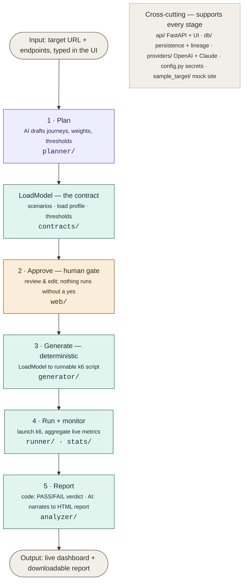

# AI Performance Testing Agent

An AI agent that **plans, generates, runs, and reports on performance tests** — all
from one web UI. You describe a target and its endpoints; the agent drafts a test
plan, you review and approve it, and the agent generates a runnable load-test
script, runs it with live monitoring, and produces a stakeholder-ready report.

> **Guiding principle:** the AI *drafts and narrates*; deterministic code *owns
> every number and the pass/fail verdict*; a *human approves* before any load is
> fired. This is what makes the tool safe to point at real infrastructure.

---

## Table of contents

- [What it does](#what-it-does)
- [Prerequisites](#prerequisites)
- [Setup](#setup)
- [Running the app](#running-the-app)
- [Running the tests](#running-the-tests)
- [Architecture](#architecture)
- [Every file explained](#every-file-explained)
- [How a request flows through the system](#how-a-request-flows-through-the-system)
- [Safety notes](#safety-notes)
- [Troubleshooting](#troubleshooting)
- [Roadmap](#roadmap)

---

## What it does

The full loop, in one browser app:

1. **Plan** — the AI drafts a structured test plan (a *LoadModel*) from your
   endpoints: realistic user journeys, traffic weights, think times, thresholds.
2. **Approve** — you review and edit the plan, then approve it. Nothing runs without this.
3. **Generate** — a deterministic renderer turns the plan into a runnable **k6**
   script (Locust also supported). No LLM touches the script — the same plan always
   produces the same script.
4. **Run + monitor** — the agent launches k6 and streams live metrics into the
   browser (requests, RPS, error rate, p95/p99 latency, per-endpoint breakdown).
5. **Report** — a deterministic pass/fail verdict against the thresholds, plus an
   AI-written plain-English summary, downloadable as a self-contained HTML report.

The load-model shape (ramp up → steady → ramp down) and all metrics/verdicts are
computed by code. The AI is only involved at two points: drafting the plan and
writing the report narrative — and in both it must use the real, computed numbers.

---

## Prerequisites

Install these on your system before running the project.

| Requirement | Why | How to check | Where to get it |
|---|---|---|---|
| **Python 3.11+** | The whole service is Python | `python --version` | https://www.python.org/downloads/ |
| **uv** *(or plain pip)* | Installs dependencies. uv is recommended; pip works too (see Setup) | `uv --version` | https://docs.astral.sh/uv/getting-started/installation/ |
| **k6** | Runs the load tests (needed only for the Run step) | `k6 version` | https://grafana.com/docs/k6/latest/set-up/install-k6/ |
| **Git** | To clone / push the repo | `git --version` | https://git-scm.com/downloads |
| **An LLM API key** | For AI planning + report narration | — | OpenAI: https://platform.openai.com/ · Anthropic: https://console.anthropic.com/ |

Notes:

- **You do NOT need k6** just to plan and generate scripts — only to actually *run*
  them from the UI. You can also download a generated script and run it on any
  machine that has k6.
- **You do NOT need an API key** to run the app skeleton or the test suite — the
  tests mock the LLM. A key is only needed for the live "Draft plan with AI" and the
  AI-written report narrative.
- **Set a spend cap** on your OpenAI/Anthropic account before using the AI features.
- Everything is cross-platform (Windows, macOS, Linux). Commands below show Windows
  where it differs (`copy` vs `cp`).

---

## Setup

You can install with **uv** (recommended, faster) or plain **pip**. Use whichever
your team prefers — both produce the same environment.

### Option A — using uv (recommended)

    git clone <your-repo-url>
    cd perfagent
    uv sync                       # installs everything, creates .venv automatically

### Option B — using pip + venv (no uv needed)

    git clone <your-repo-url>
    cd perfagent

    python -m venv .venv
    .venv\Scripts\activate         # Windows
    # source .venv/bin/activate     # macOS / Linux

    pip install -r requirements.txt              # runtime only
    # pip install -r requirements.txt -r requirements-dev.txt   # + tests & linting

### Then (both options) — create your env file

    copy .env.example .env        # Windows
    # cp .env.example .env        # macOS / Linux

Open `.env` and fill in your provider and key:

    LLM_PROVIDER=openai           # or "anthropic"
    OPENAI_API_KEY=sk-...         # fill in whichever provider you chose
    ANTHROPIC_API_KEY=
    OPENAI_MODEL=gpt-4o-2024-11-20
    ANTHROPIC_MODEL=claude-sonnet-4-5-20250929
    MAX_TOKENS=4096

`.env` is git-ignored, so your key is never committed.

> **Which files pin dependencies?** `pyproject.toml` + `uv.lock` are the source of
> truth (used by uv). `requirements.txt` (runtime) and `requirements-dev.txt` (tests
> + lint) are provided for pip users and for deployment tooling that expects them.

---

## Running the app

**Terminal 1 — start the agent (the web app + API):**

    uv run uvicorn perfagent.api.app:app --reload --port 8080

Open **http://127.0.0.1:8080** in your browser.

> Using pip instead of uv? Activate your venv first, then drop the `uv run` prefix from every command below — e.g. `uvicorn perfagent.api.app:app --reload --port 8080` and `pytest -q`.

**Terminal 2 — start the built-in mock target (something safe to test against):**

    uv run python -m perfagent.sample_target.app     # serves http://127.0.0.1:8000

**In the browser:**

1. Target `http://127.0.0.1:8000`, keep the pre-filled endpoints.
2. Set Max users (e.g. 20) and Duration (e.g. 60s).
3. Click **Draft plan with AI** — the AI proposes a plan.
4. Review/edit it, then **Approve & generate script** — a k6 script appears.
5. Click **Run & monitor live** — watch metrics stream in.
6. When it finishes, the **Report** section shows a verdict + summary you can download.

**Running a generated script yourself (optional):** download it from the UI, then

    k6 run -e BASE_URL=http://127.0.0.1:8000 loadtest.js

---

## Running the tests

The suite mocks the LLM, so it needs **no API key** and makes **no paid calls**:

    uv run pytest -q

You should see all tests pass. Lint with:

    uv run ruff check src/ tests/

---

## Architecture

The system is a pipeline of stages connected by a shared contract (the `LoadModel`).
The AI is involved in only two places — drafting the plan and writing the report
narrative. Everything else is deterministic code, and a human approves before any
load is fired.

**Who owns what (the trust boundary):**

| Colour | Owner | Stages |
|--------|-------|--------|
| Purple | **AI drafts** | Plan (and the report *narrative*) |
| Teal | **Code owns** | LoadModel, Generate, Run, metrics, verdict |
| Amber | **Human gate** | Approve — before any load fires |

The AI only touches the first stage (drafting the plan) and the wording of the final
report. Every number, the generated script, and the pass/fail verdict are produced by
deterministic code. A human approves before any load is fired.

---

## Every file explained

### Project root

| File | What it is |
|---|---|
| `pyproject.toml` | Project metadata + dependencies (used by `uv`). Also ruff/pytest config. |
| `uv.lock` | Exact pinned versions of every dependency, so installs are reproducible. |
| `requirements.txt` | Runtime dependencies for pip users / deployment (mirrors pyproject). |
| `requirements-dev.txt` | Test + lint dependencies for pip users. |
| `.env.example` | Template for environment variables. Copy to `.env` and fill in keys. |
| `.env` | Your real secrets (git-ignored — never committed). |
| `.gitignore` | Tells git to skip `.env`, the database, caches, the virtualenv, etc. |
| `README.md` | This file. |

### `src/perfagent/` — the service

| File | Responsibility |
|---|---|
| `__init__.py` | Marks the package; holds the version string. |
| `config.py` | Loads settings + secrets from `.env` via pydantic-settings. The ONLY place env vars are read. |

### `src/perfagent/contracts/` — the shared contract

| File | Responsibility |
|---|---|
| `load_model.py` | **The core data model.** Defines `LoadModel` (a whole test plan) and its parts: `Scenario` (a user journey), `Step` (one request), `ThinkTime`, `LoadProfile` + `Stage` (how load ramps over time), `Threshold` (pass/fail bounds), `HttpMethod`. All validated by Pydantic — this validation is the trust boundary. |
| `artifacts.py` | Wraps outputs with identity + lineage: `PlanArtifact` (a LoadModel with an id) and `ScriptArtifact` (a generated script that points back to the plan it came from). |
| `__init__.py` | Re-exports the above for easy importing. |

### `src/perfagent/providers/` — the LLM layer

| File | Responsibility |
|---|---|
| `base.py` | Defines `LLMProvider`, the single interface the rest of the code calls. Nothing outside this folder imports the OpenAI/Anthropic SDKs. |
| `openai_provider.py` | OpenAI implementation, using Instructor to return validated Pydantic objects. |
| `anthropic_provider.py` | Anthropic (Claude) implementation, same interface. |
| `__init__.py` | `build_provider()` — reads config and returns the configured provider. |

### `src/perfagent/planner/` — Stage 1: Plan

| File | Responsibility |
|---|---|
| `spec.py` | `EndpointSpec` and `PlanRequest` — the Planner's input (endpoints + target + goal + guard rails). |
| `prompts.py` | The system + user prompts that instruct the AI how to draft a plan. |
| `profile.py` | **Deterministic** load-profile builder: turns "peak users + duration" into a proper ramp-up → steady → ramp-down shape. Code owns this, not the AI. |
| `planner.py` | `draft_plan()` — asks the provider for a LoadModel, then applies deterministic controls (forces the target URL, replaces the load-profile shape with `profile.py`'s output). |
| `__init__.py` | Re-exports `draft_plan`, `EndpointSpec`, `PlanRequest`. |

### `src/perfagent/generator/` — Stage 3: Generate

| File | Responsibility |
|---|---|
| `k6_renderer.py` | Turns a LoadModel into a runnable **k6** script (the primary tool). Pure templating + arithmetic; no LLM. |
| `locust_renderer.py` | Same, for Locust (alternative tool). |
| `templates/k6.js.j2` | The Jinja2 template for k6 scripts. |
| `templates/locust.py.j2` | The Jinja2 template for Locust scripts. |
| `__init__.py` | `render()` / `generate_script()` — dispatches to the right renderer by tool name. Adding a new tool = one new renderer here. |

### `src/perfagent/runner/` — Stage 4: Run

| File | Responsibility |
|---|---|
| `k6_runner.py` | Launches k6 as a subprocess with JSON output, parses the stream, tracks each run's live state in memory, and lets a run be stopped. Falls back to a clear error if k6 isn't installed. |
| `__init__.py` | Re-exports the runner functions. |

### `src/perfagent/stats/` — deterministic metrics

| File | Responsibility |
|---|---|
| `aggregator.py` | Consumes k6's raw metric points and computes the numbers the UI shows: request counts, error rate, RPS, and latency percentiles (via NumPy), including per-endpoint. **Every number comes from here, never the AI.** |
| `__init__.py` | Re-exports `Aggregator`. |

### `src/perfagent/analyzer/` — Stage 5: Report

| File | Responsibility |
|---|---|
| `verdict.py` | **Deterministic** PASS/FAIL: compares the run's actual metrics against the plan's thresholds. Code decides the verdict, never the AI. |
| `narrator.py` | Produces a plain-English `Narrative` from the computed numbers + verdict, using the LLM — with a deterministic template fallback if no key is set, so a report can always be produced. |
| `report.py` | Renders everything into a self-contained, downloadable HTML report. |
| `__init__.py` | Re-exports `evaluate`, `narrate`, `Narrative`, `render_report_html`. |

### `src/perfagent/db/` — persistence

| File | Responsibility |
|---|---|
| `models.py` | SQLAlchemy models `PlanRow` and `ScriptRow` (script points back to its plan = lineage), plus the engine/session setup. Uses SQLite by default. |
| `__init__.py` | Re-exports the models and session helpers. |

### `src/perfagent/api/` — the web service

| File | Responsibility |
|---|---|
| `app.py` | The FastAPI application. Serves the UI at `/` and exposes the REST API: plan, generate, list/get plans, download script, run, poll run status, stop run, and the report endpoints. |
| `__init__.py` | Marks the package. |

### `src/perfagent/web/` — the UI

| File | Responsibility |
|---|---|
| `index.html` | The entire browser UI in one file (HTML + CSS + JS). Talks to the API. Sections: describe test, review/approve plan, generated script, live monitor, stakeholder report, saved plans. |

### `src/perfagent/sample_target/` — a safe test target

| File | Responsibility |
|---|---|
| `app.py` | A tiny mock website (`/products`, `/login`, `/cart`, `/checkout`) using only the Python standard library, so you always have something safe to load-test. |
| `__init__.py` | Marks the package. |

### `tests/` — the test suite (all mock the LLM)

| File | What it checks |
|---|---|
| `test_load_model.py` | The LoadModel schema validates correctly (bad URLs, paths, think times rejected). |
| `test_generator.py` | The generator dispatch + Locust rendering, determinism, lineage. |
| `test_k6_renderer.py` | k6 script generation: valid output, weighted VU split, thresholds, no zero-user scenarios. |
| `test_planner.py` | The Planner builds prompts, applies deterministic controls, produces valid plans (with a fake provider). |
| `test_profile.py` | The deterministic load-profile builder (ramp/spike/soak/stress shapes). |
| `test_runner.py` | The metrics aggregator and the runner's guard behavior (missing k6, wrong tool). |
| `test_analyzer.py` | The deterministic verdict, the narration fallback, and HTML report rendering. |
| `test_api.py` | End-to-end API flow with a fake provider and a temp database. |

---

## How a request flows through the system

A concrete example — you click "Draft plan with AI":

1. The browser (`web/index.html`) POSTs your endpoints to `/api/plan` in `api/app.py`.
2. `app.py` calls `providers.build_provider()` to get the configured LLM, then
   `planner.draft_plan()`.
3. `planner.py` builds prompts (`prompts.py`), asks the provider for a `LoadModel`
   (validated by `contracts/load_model.py`), then forces the target URL and replaces
   the load-profile shape using `profile.py`.
4. `app.py` saves it via `db/models.py` and returns the plan JSON to the browser.
5. You review it and click approve+generate → `/api/plan/{id}/generate` →
   `generator/` renders a k6 script → saved with lineage → shown in the UI.
6. You click run → `/api/scripts/{id}/run` → `runner/k6_runner.py` launches k6;
   `stats/aggregator.py` computes live metrics; the browser polls `/api/runs/{id}`.
7. On finish → `/api/runs/{id}/report` → `analyzer/` computes the verdict
   (`verdict.py`), narrates it (`narrator.py`), and can render the HTML
   (`report.py`) for download.

---

## Safety notes

- **Only run load against systems you own or have explicit written permission to
  test.** Generating load against systems you don't control can cause outages and may
  be illegal.
- The human approval gate sits *before* any load is fired — always review the plan
  and script first.
- Start with low user counts and short durations on any new target, then scale up.
- The tool never fires load on its own — a human clicks Run.

---

## Troubleshooting

| Symptom | Cause / fix |
|---|---|
| "k6 is not installed or not on PATH" | Install k6 and reopen the terminal. Check with `k6 version`. |
| "OPENAI_API_KEY is not set" (or ANTHROPIC) | Fill the key in `.env` and restart the app. |
| Plan step errors immediately | Wrong `LLM_PROVIDER` vs which key you filled in, or no spend left on the account. |
| The run shows 0 requests / connection errors | The target isn't running. Start the mock target, or check your real target URL. |
| Generated script won't run in k6 | Regenerate it (older scripts from earlier versions may differ); ensure the file saved as UTF-8. |
| Tests fail on import | Run `uv sync` again; make sure you're using the project's `.venv`. |

---

## Roadmap

**Working today:** the full loop — plan, approve, generate (k6), run, live monitor,
report — via the web UI, backed by a database with lineage.

**Planned next:**
- Authentication / correlation (log in, capture tokens) — to test authenticated sites
- Discovery — crawl a site or ingest real traffic (HAR / traces) instead of typing endpoints
- Baseline comparison / regression detection across runs
- PDF report export
- More tool renderers (JMeter, Gatling) and deeper Locust support
- Run persistence, multi-tenancy, tool-level auth, CI/CD integration (enterprise hardening)

---

## Design documents

See the `docs/` folder for the architecture, approach, reference-repo teardown, and
tech-stack decisions.