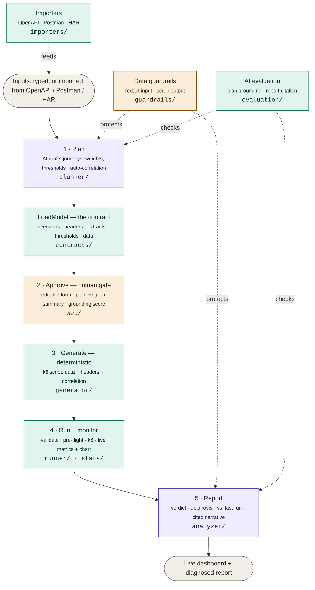

<div align="center">

# ⚡ AI Performance Testing Agent

**Plan, generate, run, and diagnose performance tests from one guided web app —
powered by AI where it helps, deterministic code where it matters.**

Describe (or import) your API → the AI drafts a realistic test plan → you review & approve →
the agent generates a k6 script, runs it with live monitoring, and delivers a diagnosed,
stakeholder-ready report that compares against your last run.

</div>

> [!IMPORTANT]
> **Guiding principle — _AI proposes, code proves, humans approve._**
> The AI only *drafts the plan* and *writes the narrative*. Deterministic code owns every
> number, the generated script, and the pass/fail verdict. A human approves before any
> load is fired, and **sensitive data is redacted before it ever reaches the AI.**

---

## Table of contents

- [Why this exists](#why-this-exists)
- [The 5-step workflow](#the-5-step-workflow)
- [Feature highlights](#feature-highlights)
- [Quick start](#quick-start)
- [Prerequisites](#prerequisites)
- [Setup](#setup)
- [Running the app](#running-the-app)
- [Running the tests](#running-the-tests)
- [How it works](#how-it-works)
- [Data guardrails](#data-guardrails)
- [AI evaluation](#ai-evaluation)
- [Architecture](#architecture)
- [Project layout](#project-layout)
- [Safety notes](#safety-notes)
- [Troubleshooting](#troubleshooting)
- [Roadmap](#roadmap)

---

## Why this exists

Performance testing is slow and expert-bound: deciding *what* to test is tribal
knowledge, writing load scripts is error-prone, and reading results is inconsistent. This
agent compresses that loop — **minutes instead of hours** — while keeping humans in
control of every decision that matters and keeping the AI away from anything that must be
exact.

| Traditional performance testing | With this agent |
|---|---|
| Hand-pick endpoints & journeys | AI drafts realistic journeys from your endpoints (or an imported spec) |
| Hand-write & maintain scripts | Deterministic generation — the same plan always yields the same script |
| Set up auth/token flow manually | AI auto-detects login → token → reuse (correlation) |
| Stare at raw metrics | Plain-English report + automatic bottleneck diagnosis |
| "Is it worse than last time?" — unknown | Automatic **baseline comparison** flags regressions |

---

## The 5-step workflow

```
  1 ─ Describe ──▶ 2 ─ Review & Approve ──▶ 3 ─ Generate ──▶ 4 ─ Run & Monitor ──▶ 5 ─ Report
  endpoints or        editable form,          k6 script         live metrics +        verdict +
  import a spec       grounding score         (deterministic)   chart, pre-flight     diagnosis +
                      + guardrail badge                                               vs. last run
```

1. **Describe** — type endpoints, **or import** them from OpenAPI/Swagger, Postman, or a HAR capture. Optionally add a data file, custom headers, and pick a test type (ramp / spike / soak / stress).
2. **Review & approve** — the AI drafts a plan; you edit it in a **form** (weight sliders, think-times, thresholds — no JSON) and a plain-English summary explains what the test does and why. Approve to continue.
3. **Generate** — a deterministic renderer produces a runnable **k6** script (Locust also supported). No LLM touches the script.
4. **Run & monitor** — **validate** the script (1-pass smoke check) and **pre-flight** the endpoints, then launch k6 with live tiles + chart.
5. **Report** — a **PASS / FAIL / INCONCLUSIVE** verdict, an automatic **diagnosis** (bottlenecks, latency tail, concurrency impact), a **comparison to your previous run**, and an AI narrative whose every figure is verified against the real metrics.

---

## Feature highlights

### 🧭 Discover & import
- **OpenAPI / Swagger** (JSON **or YAML**) — imports every path + method, sample bodies from the schema, infers the target URL.
- **Postman collections** — requests (incl. nested folders) with bodies.
- **HAR captures** — the real requests from a recorded session (static assets & duplicates filtered out).

### 🔐 Real-world auth & data
- **Correlation** — capture a login token / created id from a response (**JSON field, response header, or cookie**) and reuse it in later requests as `${var}`. The AI sets this up automatically for login flows.
- **Custom headers** — global `Authorization` / API-key headers; values can reference captured variables.
- **Data parameterization** — upload CSV/TSV/TXT/JSON/JSONL; each virtual user picks a row via `${column}`.

### ⏱ Realistic load
- **Test types** — ramp, **spike**, **soak**, **stress**, each a genuinely different load shape.
- **Editable plan form** — scenarios, weights, think-times, thresholds — with a raw-JSON toggle for power users.

### ✅ Trust & safety
- **Data guardrails** — secrets/PII/URLs redacted before the AI; AI output scrubbed.
- **AI evaluation** — plan grounding (no invented endpoints) + report citation (no fabricated numbers).
- **Fail-closed verdict** — an unmeasurable threshold → **INCONCLUSIVE**, never a silent PASS.

### 🔎 Run & diagnose
- **Pre-flight check** — one request per endpoint, status codes shown before a full run.
- **Script validation** — `k6 inspect` catches script errors before you spend a full run.
- **Live monitoring** — real-time tiles (RPS, errors, p95/p99) + a live chart.
- **Diagnosis engine** — slowest / most error-prone endpoint, latency-tail, concurrency impact, with recommendations.
- **Baseline / regression** — every run is stored and compared to the previous run of the same plan ("p95 got 50% worse").

### 🧰 Convenience
- **Run an existing script** — upload a finished k6 file and run it, skipping planning.
- **Saved plans** — reopen a plan and its latest script; re-run without regenerating.
- **Downloadable HTML report** for stakeholders.

---

## Quick start

```bash
# 1. install
uv sync

# 2. configure your LLM key
copy .env.example .env        # then edit .env

# 3. run the agent
uv run uvicorn perfagent.api.app:app --reload --port 8080

# 4. (separate terminal) start the safe demo target
uv run python -m perfagent.sample_target.app

# 5. open http://127.0.0.1:8080  →  Draft plan → Approve → Run
```

---

## Prerequisites

| Requirement | Why | Check | Get it |
|---|---|---|---|
| **Python 3.11+** | The service is Python | `python --version` | <https://www.python.org/downloads/> |
| **uv** *(or pip)* | Dependency manager | `uv --version` | <https://docs.astral.sh/uv/getting-started/installation/> |
| **k6** | Runs & validates the load tests | `k6 version` | <https://grafana.com/docs/k6/latest/set-up/install-k6/> |
| **Git** | Clone / push | `git --version` | <https://git-scm.com/downloads> |
| **LLM API key** | AI planning + narration | — | [OpenAI](https://platform.openai.com/) · [Anthropic](https://console.anthropic.com/) |

> [!NOTE]
> - You **don't** need k6 to plan/generate — only to *run* or *validate*.
> - You **don't** need an API key to run the test suite — the tests mock the LLM.
> - Set a **spend cap** on your provider account before using the AI features.

---

## Setup

<details>
<summary><b>Option A — uv (recommended)</b></summary>

```bash
git clone <your-repo-url>
cd perfagent
uv sync
```
</details>

<details>
<summary><b>Option B — pip + venv</b></summary>

```bash
git clone <your-repo-url>
cd perfagent
python -m venv .venv
.venv\Scripts\activate          # Windows  (source .venv/bin/activate on mac/linux)
pip install -r requirements.txt
```
</details>

Then create your environment file:

```bash
copy .env.example .env          # Windows  (cp on mac/linux)
```

```ini
LLM_PROVIDER=openai             # or "anthropic"
OPENAI_API_KEY=sk-...
ANTHROPIC_API_KEY=
```

> `.env` is git-ignored, so your key is never committed.

---

## Running the app

**Terminal 1 — the agent (web UI + API):**
```bash
uv run uvicorn perfagent.api.app:app --reload --port 8080
```
Open **<http://127.0.0.1:8080>**.

**Terminal 2 — the built-in mock target (safe to load-test):**
```bash
uv run python -m perfagent.sample_target.app      # http://127.0.0.1:8000
```

Then: **Describe** (or import) → **Draft plan with AI** → review/edit → **Approve** →
**Generate** → **Validate / Pre-flight** → **Run & monitor** → **Report**.

---

## Running the tests

The suite mocks the LLM — **no API key, no paid calls, no k6 required**:

```bash
uv run pytest -q
```

Lint:

```bash
uv run ruff check src/ tests/
```

---

## How it works

A concrete trace — you click **"Draft plan with AI"**:

1. The browser posts your endpoints to `POST /api/plan`.
2. The API builds a **guarded** LLM provider — the guardrail **redacts** secrets/URLs from
   the prompt *before* the model sees them.
3. The planner asks the model for a `LoadModel` (validated against the schema), then
   **deterministic code takes over**: it forces the target URL, applies the chosen load
   profile, collapses duplicate journeys, sanity-fixes thresholds, and auto-adds the auth
   header when a token is captured.
4. The API returns the plan + a **grounding score** + the **redaction summary**.
5. You approve → `POST /api/plan/{id}/generate` renders the k6 script (data + headers +
   correlation) deterministically.
6. You run → `k6` launches, the aggregator computes metrics, the browser polls live.
7. On finish → the API computes the **verdict**, **diagnosis**, and **baseline comparison**,
   and the AI writes a narrative whose numbers are **citation-checked** against the metrics.

---

## Data guardrails

A guardrail layer wraps **every** LLM call (via the provider interface), so both the
planner and the reporter are covered — there is no path to the model that bypasses it.

| Category | Handling |
|---|---|
| Emails, passwords, tokens, JWTs, cards (Luhn), SSNs, inline secrets | one-way redaction |
| URL query secrets (`?token=…`) | one-way redaction |
| URL hostnames, internal hosts, private IPs | reversible (restored in reports) |
| `${placeholder}` template references | preserved (not treated as secrets) |

Only redaction **counts** are ever surfaced or logged — never the raw values. After
drafting, the UI shows e.g. *"🛡 2 sensitive values redacted before sending to the AI."*

---

## AI evaluation

Guardrails protect what goes *into* the AI; the evaluation harness verifies what comes
*out*, deterministically, against ground truth:

- **Plan grounding** — only supplied endpoints are used (no invention), weights/think-times
  are valid, and the plan stays within the requested guard rails →
  *"✅ Plan grounded — 6/6 checks passed."*
- **Report citation** — every number in the narrative must trace to a real computed
  metric; fabricated figures are flagged (URLs and timestamps are ignored) →
  *"✅ Report verified — all N figures trace to real metrics."*

---

## Architecture



**Trust boundary**

| Owner | Responsible for |
|---|---|
| 🟣 **AI** | What journeys to test, weights, think-times; the report narrative |
| 🟢 **Code** | Load shape, the generated script, every metric, verdict, diagnosis, baseline |
| 🟡 **Human** | Approving the plan before any load is fired |
| 🟡 **Guardrails** | Redacting sensitive data before the AI sees it |

---

## Project layout

| Path | Responsibility |
|---|---|
| `contracts/load_model.py` | Core model: `LoadModel`, `Scenario`, `Step`, `Extract` (correlation), `LoadProfile`, `Threshold`, `DataFile`, `headers`. |
| `importers/endpoints.py` | Import endpoints from OpenAPI/Swagger (JSON+YAML), Postman, HAR. |
| `guardrails/` | Redaction engine + output scrubbing around every LLM call. |
| `evaluation/` | Plan-grounding and report-citation checks. |
| `providers/` | OpenAI / Anthropic behind one interface (Instructor), wrapped by guardrails. |
| `planner/` | Endpoints → AI-drafted LoadModel; deterministic controls (target, profile, sanity, auto-correlation). |
| `generator/k6_renderer.py` · `k6_data.py` · `k6_corr.py` · `templates/` | LoadModel → k6 script (data, headers, correlation). |
| `generator/locust_renderer.py` | Locust renderer (alternative tool). |
| `preflight.py` | One request per endpoint → status report (no load). |
| `runner/k6_runner.py` · `runner/validator.py` | Launch & stream k6; validate a script via `k6 inspect`. |
| `stats/aggregator.py` | Deterministic metric aggregation (percentiles, error rate, RPS). |
| `analyzer/verdict.py` · `diagnostics.py` · `baseline.py` · `narrator.py` · `report.py` | Verdict (fail-closed), diagnosis, regression compare, AI narrative, HTML report. |
| `db/models.py` | SQLAlchemy models: plans, scripts, data files, run results. |
| `api/app.py` | FastAPI app: REST API + serves the UI. |
| `web/index.html` | The guided wizard UI (single file). |
| `sample_target/app.py` | A mock website to test against safely. |

**Tests** cover the schema, generators, planner & profiles, runner/stats/validator,
analyzer (incl. fail-closed verdict, diagnostics, baseline), API, guardrails (incl. URL &
placeholder handling), evaluation, data, importers, headers/pre-flight, and correlation
(JSON/header/cookie).

---

## Safety notes

> [!WARNING]
> **Only run load against systems you own or have explicit written permission to test.**
> Generating load against systems you don't control can cause outages and may be illegal.

- The human approval gate sits **before** any load is fired — always review the plan first.
- Start with low user counts and short durations on any new target, then scale up.
- Sensitive data is redacted before it reaches the LLM, but extend the detectors in
  `guardrails/redaction.py` for your environment before pointing at production-adjacent data.

---

## Troubleshooting

| Symptom | Fix |
|---|---|
| "k6 is not installed or not on PATH" | Install k6, reopen the terminal, check `k6 version`. |
| "OPENAI_API_KEY is not set" | Fill the key in `.env` and restart the app. |
| Run shows 0 requests / "Run error" | The target isn't running, or the URL is wrong. Start the target and retry. |
| Imported a spec but no endpoints | Confirm it's a valid OpenAPI (JSON/YAML), Postman collection, or `.har`. |
| Script "failed validation" but pre-flight passed | Regenerate the script; ensure it saved as UTF-8. |
| `/me` (or a protected call) returns 401 in pre-flight | Expected — pre-flight hits endpoints in isolation; correlation only flows the token during a full run. |
| Tests fail on import | Run `uv sync` again; make sure you're in the project `.venv`. |

---

## Roadmap

**✅ Working today**
Import (OpenAPI/Swagger JSON+YAML, Postman, HAR) · AI planning with an editable form &
plain-English summary · guardrails · AI evaluation · data parameterization · custom
headers · correlation (JSON/header/cookie, auto-set-up) · test types (ramp/spike/soak/stress) ·
pre-flight check · script validation · live monitoring + chart · diagnosis engine ·
fail-closed verdict · baseline/regression · run-an-existing-script · cited reports.

**🔭 Planned next**
- **Autonomy & reach** — MCP server interface (use the agent from Cursor / Claude Code / CI);
  scheduled & CI-triggered runs; LangGraph orchestration.
- **More tools** — JMeter / Gatling runners; regex extraction.
- **Hosting / enterprise** — durable run state (Postgres + job queue), separate load
  workers, authentication & RBAC, target allow-list & safety rails, multi-tenancy,
  WebSockets, observability.

---

<div align="center">
<sub>Built with FastAPI · k6 · Pydantic · Instructor · OpenAI / Anthropic · SQLAlchemy</sub>
</div>