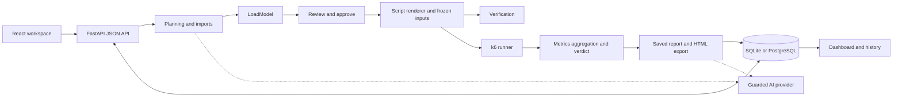

# Architecture and AI roles

[Back to PerfAgent](../README.md)

## Technology stack

| Layer | Technologies and responsibilities |
|---|---|
| Frontend | React 19, TypeScript, React Router 7, Vite 8, CSS, and Canvas charts. FastAPI serves the production build. |
| API and contracts | Python 3.11+, FastAPI, Uvicorn, Pydantic, and OpenAPI. Shared contracts describe targets, workloads, requests, assertions, and thresholds. |
| Persistence | SQLAlchemy 2, Alembic, SQLite for local use, and PostgreSQL through psycopg. LangGraph uses a SQLite or PostgreSQL checkpoint backend for conversation state. |
| Planning and reporting | OpenAI or Anthropic through the server-side provider adapter, Instructor for structured responses, and LangGraph for conversation state and routing. |
| Execution | k6 for the integrated verification and live-run workflow. Python and Jinja2 render scripts. The project also has generators for Locust, JMeter, and Gatling. |
| Observability and QA | structlog, Prometheus metrics, pytest, Vitest, and a headless Chromium smoke harness with fixture APIs. |

## AI roles

| Role | What it helps with | Implementation |
|---|---|---|
| Conversation assistant | Collects missing details and prepares a draft from a conversation. | [LangGraph conversation workflow](../src/perfagent/chat/graph.py) |
| Test planner | Suggests journeys, traffic weights, and checks. Application code restores explicit inputs and applies the selected workload rules. | [Planner](../src/perfagent/planner/planner.py) |
| Request data and check suggestions | Suggests value sources for a body or response assertions from a supplied sample, for the user to review. | [Dynamic data suggestions](../src/perfagent/dynamize.py), [check suggestions](../src/perfagent/check_suggest.py) |
| Report narrator | Explains computed results and can fall back to a rule-based summary when a provider is unavailable. | [Report narrator](../src/perfagent/analyzer/narrator.py) |

These roles share the application's guarded provider interface. Application code controls validation, script generation, run execution, metrics, and the verdict. The user selects when to verify or run.

## How it works

A concrete trace — you draft a plan:

1. Your endpoints (and any pasted collection) post to the API.
2. The API builds a **guarded** LLM provider — the guardrail **redacts** secrets/URLs from
   the *user* prompt before the model sees them (the system prompt is left intact).
3. The planner asks the model for a `LoadModel`, then **deterministic code takes over**: it
   forces the target URL, applies the chosen load profile, collapses duplicate journeys,
   sanity-fixes thresholds, auto-adds the auth header when a token is captured, and
   **restores your real request bodies** (the model only ever saw redacted ones).
4. The API returns the plan + a **grounding score** + the **redaction summary** + token usage.
5. You approve → the k6 script is rendered deterministically (data + headers + correlation +
   dynamic generators + assertions + TLS). You can edit it before running.
6. You run → k6 launches, the aggregator computes metrics (counting failed assertions as
   errors), the browser polls live metrics and **run logs**.
7. On finish → the API computes the **verdict**, **diagnosis**, and **baseline comparison**,
   writes a **citation-checked** narrative, and **saves the full report** (checks + logs
   included). Every consequential action (and its token cost) is audited.

---

## Data guardrails

A guardrail layer wraps **every** LLM call (via the provider interface) — there is no path to
the model that bypasses it. Only the **user** prompt (which carries user data) is redacted;
the fixed system prompt is left intact.

| Category | Handling |
|---|---|
| Emails, passwords, tokens, JWTs, cards (Luhn), SSNs, inline secrets | one-way redaction |
| URL query secrets (`?token=…`) | one-way redaction |
| URL hostnames, internal hosts, private IPs | reversible (restored in reports) |
| `${placeholder}` / `{{var}}` template references | preserved (not treated as secrets) |

The same guardrail protects **✨ Suggest checks from a response**: the pasted response is
redacted before the AI sees it. Only redaction **counts** are surfaced — never raw values. A
standalone `verify_guardrails.py` script and a `GUARDRAIL_DEBUG=1` mode (logs the *redacted*
prompt) let you confirm nothing sensitive reaches the AI before testing real endpoints.

---

## AI evaluation

- **Plan grounding** — only supplied endpoints are used, weights/think-times valid, within
  guard rails → *"✅ Plan grounded — 6/6 checks passed."*
- **Report citation** — every number in the narrative must trace to a real computed metric;
  fabricated figures are flagged (URLs and timestamps ignored) → *"✅ Report verified."*

## Architecture

The React workspace calls the FastAPI JSON API. `LoadModel` is the shared test specification.
Approval saves or reuses a script version with frozen execution inputs. The runner
streams k6 events into the aggregator. The analysis layer computes threshold outcomes
and baseline changes, then saves the report for the dashboard and standalone HTML export.



The UI also supports importing existing k6 scripts and recovering saved reports after a server restart.
Local and managed access have different deployment requirements. In managed mode the landing page, sample demo, and sign-in entry at `/`, `/demo`, and `/sign-in` can be served publicly with their static bundles. The access gateway must allow those read routes and intercept `/workspace` and other protected routes. Configure the gateway to require MFA and assert the stable subject of an invited member. The sign-in entry directs visitors to the workspace so the gateway can start its login flow. Organization account creation, invitation delivery, and sign-out are handled by the gateway or identity provider.

Managed gateway checks apply at the
workspace boundary. Managed mode blocks preflight, load and smoke runs, and Jenkins triggers
at the API. Local mode supports those operations. In managed mode, set `PERFAGENT_PROJECT_GRANTS` to a JSON
object mapping gateway subjects to existing project IDs and `viewer` or `editor` roles.
Viewers can see scoped test listings, metrics, and saved reports. Editors can also open or
edit scripts, update project settings, save workload presets, and approve release policies.
Project provisioning, new test drafts, and unscoped integrations stay in local mode for this
increment. An administrator can enable **offline script validation** for editors by preloading a trusted
Docker k6 image and setting `PERFAGENT_MANAGED_K6_IMAGE` to its repository and SHA-256 digest.
Inspection runs as an unprivileged user in a read-only container with networking disabled, bounded
resources, and a deadline. Script readiness reports the configured project origin and workload
limits. Managed traffic still requires a worker with enforced egress and PostgreSQL row-level
security remains separate hosted deployment work.

The managed egress broker is tested against a local TLS fixture. It accepts only origin-relative
requests, connects to one operator-pinned IP, verifies the configured HTTPS certificate hostname, and
returns redirect responses without following them. It bounds admitted request rate, concurrent
connections, request and response size, and run duration. The API still blocks managed traffic
until isolated workers can reach this broker as their only egress route. The private
per-run Unix socket transport carries bounded request and response frames, exposes no TCP
listener, and closes the broker and socket when the session ends. The worker job starts k6 and an ephemeral loopback adapter together, overrides the target with that adapter,
disables redirects, and streams k6 metrics to its supervisor. The Docker launcher pins the worker image, disables networking, and mounts only the frozen inputs
and that run’s private broker socket as read-only. Run the broker and Docker daemon on the same
Linux host so they share the Unix socket. Docker Desktop on macOS could build and run the
network-disabled image, but its daemon could not mount the host socket across the VM boundary.

On a Linux Docker host, build and verify the worker using the local TLS fixture.

```bash
docker build --network=none -f deploy/managed-worker.Dockerfile -t perfagent-managed-worker:local .
PERFAGENT_TEST_WORKER_IMAGE="$(docker image inspect perfagent-managed-worker:local --format '{{.Id}}')" \
  .venv/bin/pytest -q tests/test_managed_egress.py
```

The runner can collect the managed worker’s metric stream and final k6 threshold summary.
Stop and timeout close its broker and clean up the worker before freeing the run slot.
Brokered runs have a separate workload fingerprint so release comparisons only match runs
using the same transport. Managed Start remains disabled pending Linux end-to-end verification
and API activation.


---

## Project layout

| Path | Responsibility |
|---|---|
| `config.py` | Settings + secrets from `.env` (incl. `log_level`, `guardrail_debug`, Git/Jenkins allow-lists). |
| `contracts/load_model.py` | Core model: `LoadModel`, `Scenario`, `Step`, `Extract`, `Assertion`, `LoadProfile`, `Threshold`, `DataFile`, `headers`, `environment`, `insecure_tls`. |
| `chat_intent.py` | Chat → structured plan intent (plain-English describe). |
| `chat/` | Conversation mode: `draft.py` (per-turn schema, deterministic merge + readiness), `prompts.py`, `graph.py` (the LangGraph graph), `planning.py` (hand-off to the planner), `service.py` (sessions, secret masking, checkpointing). |
| `plan_summary.py` | Shared plan rationale / guardrail / token-usage summaries. |
| `dynamize.py` | AI "add dynamic data" — assign generators/CSV columns to a body's fields. |
| `check_suggest.py` | AI "suggest checks from a response" — propose assertions from a pasted response. |
| `importers/endpoints.py` | Import endpoints from OpenAPI/Swagger (JSON+YAML), Postman, HAR. |
| `guardrails/` | Redaction engine + output scrubbing around every LLM call. |
| `evaluation/` | Plan-grounding and report-citation checks. |
| `usage.py` · `tracing.py` | Token-usage extraction + rough cost estimate; per-AI-call traces. |
| `providers/` | OpenAI / Anthropic behind one interface (Instructor), wrapped by guardrails. |
| `planner/` | Endpoints → AI-drafted LoadModel; deterministic controls (target, profile, sanity, auto-correlation, real-body restore). |
| `generator/k6_renderer.py` · `k6_data.py` · `k6_corr.py` · `generators.py` · `templates/` | LoadModel → k6 script (data, headers, correlation, dynamic generators, assertions, logging). |
| `generator/locust_renderer.py` · `jmeter_renderer.py` · `gatling_renderer.py` | Locust, JMeter (.jmx), and Gatling (.scala) renderers. |
| `gitexport/` | Build a CI-ready k6 framework (`framework.py`), publish to Git (`publisher.py`), import back (`importer.py`), file templates (`templates.py`). |
| `ci/jenkins.py` | Jenkins trigger / status / stop / job set-up. |
| `integrations.py` | Saved (non-secret) Git & Jenkins details per plan. |
| `preflight.py` | One request per endpoint → status report (no load). |
| `runner/k6_runner.py` · `runner/validator.py` · `runner/k6_binary.py` | Launch & stream k6 (metrics + logs); validate a script via `k6 inspect`; find or auto-download k6. |
| `stats/aggregator.py` | Deterministic metric aggregation (percentiles, error rate, RPS; failed checks count as errors). |
| `analyzer/verdict.py` · `diagnostics.py` · `baseline.py` · `narrator.py` · `report.py` | Verdict (fail-closed), diagnosis, regression compare, AI narrative, HTML report. |
| `logging_config.py` · `audit.py` | Structured logging and the audit trail. |
| `api/docs.py` | Every API endpoint documented in one place: group, summary, access level, AI use. |
| `request_data.py` | Where each request value comes from (fixed / data file / generated), sample values, and the request preview. |
| `db/connection.py` · `db/migrate.py` · `db/migrations/` | Database URL handling (SQLite / Postgres), write-time safety, and Alembic migrations applied on start-up. |
| `db/models.py` | SQLAlchemy models: plans, scripts, data files, run results (+ saved reports & logs), audit, SLA profiles, traces, integration settings, chat sessions. |
| `api/app.py` + `api/*_routes.py` | FastAPI app: REST API + serves the UI; export / git-import / integration / jenkins / chat routes. |
| `web/index.html` | The guided wizard UI (conversation + quick + manual modes, report dashboard, git/Jenkins panels, single file). |
| `sample_target/app.py` | A mock website to test against safely. |

**Tests** cover the schema, generators (incl. realistic + Postman syntax), planner & profiles
& body-restore, runner/stats/validator, analyzer (fail-closed verdict, diagnostics, baseline),
API, guardrails (URL + placeholder), evaluation, data, importers, headers/pre-flight,
correlation (JSON/header/cookie/regex/array), assertions (incl. failed checks counting as
errors), suggested checks & environment/TLS, chat intent, dynamize, console logging, audit,
token usage, SLA profiles, trend, JMeter/Gatling, tracing, GraphQL, k6 auto-provisioning, and
the Git export / import / Jenkins / integrations features.
