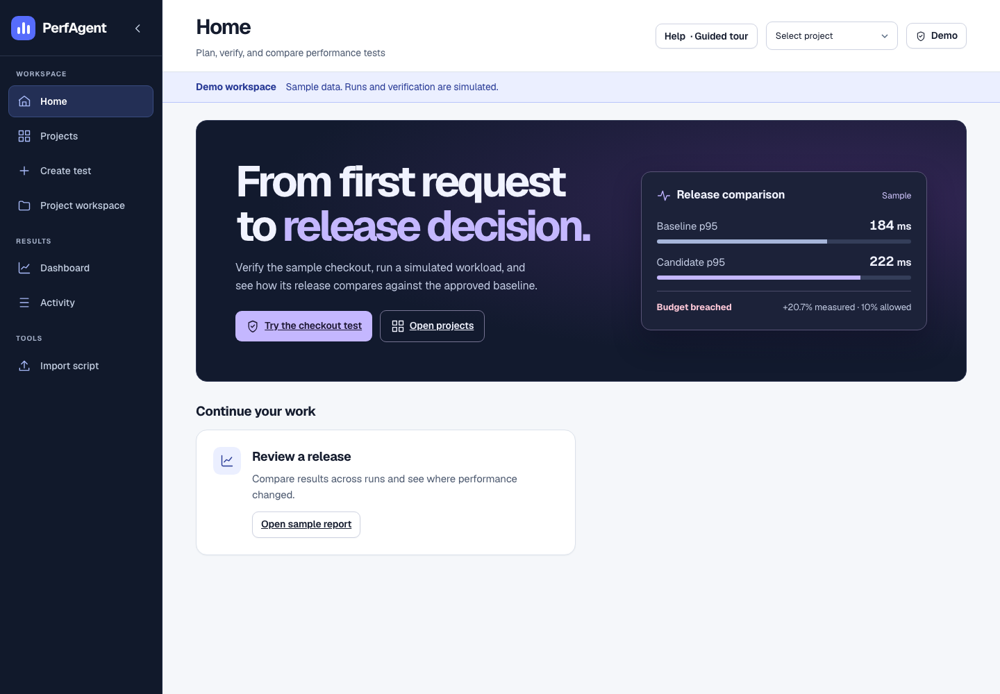
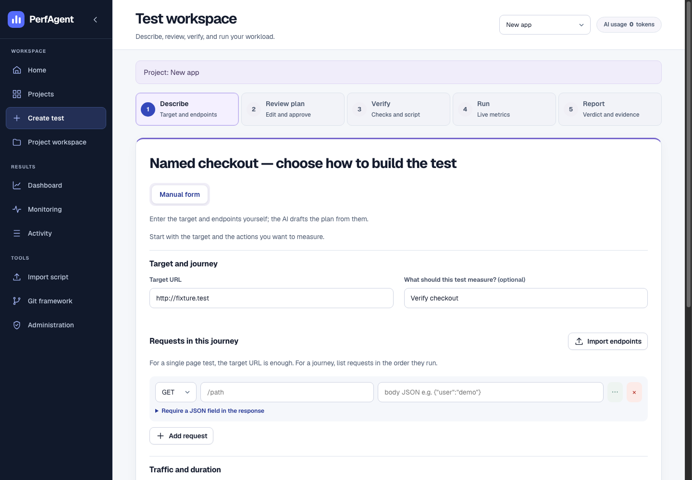
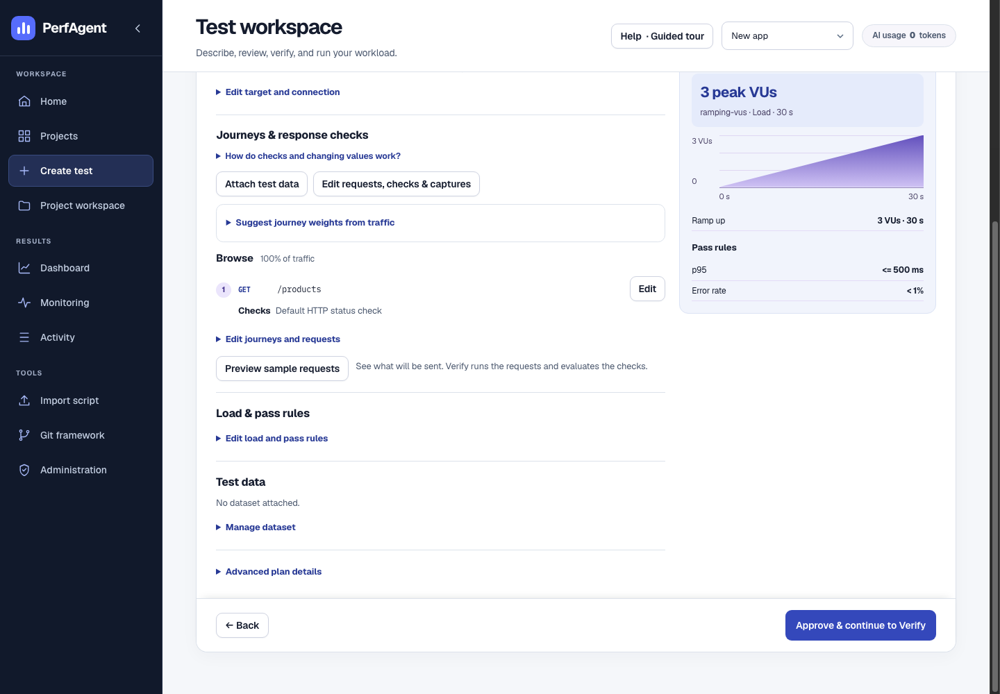
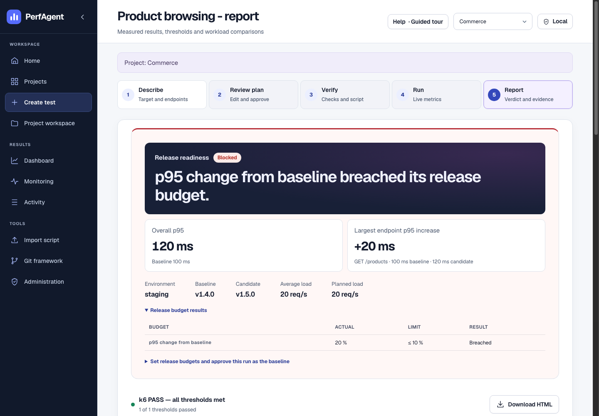
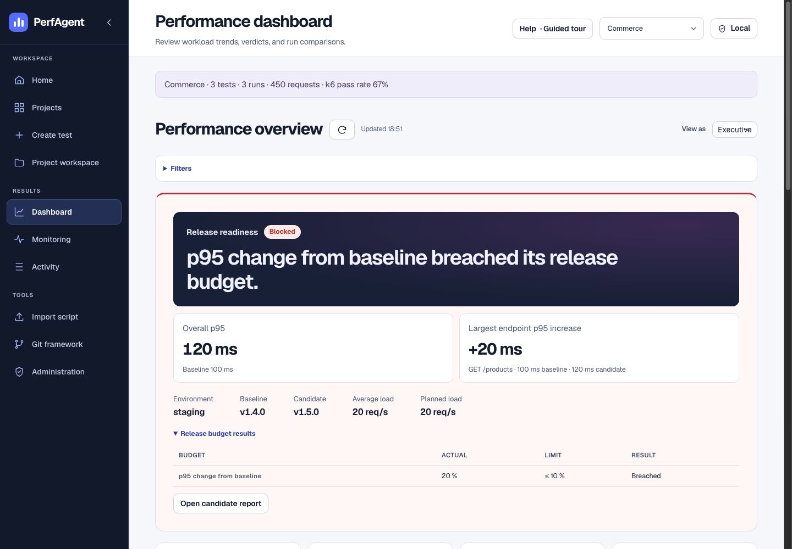

# PerfAgent UI field guide

A hands-on guide for QA engineers, developers, and release reviewers. Follow the first lab to learn the workflow, then use the feature tables and verification checklist to test individual capabilities.

[First test](#first-test-local-checkout) · [Feature map](#feature-map) · [Workload design](#design-the-workload) · [Test data and checks](#configure-data-and-response-checks) · [Read a report](#read-the-report-and-make-a-release-decision) · [Monitoring](#monitor-the-run-and-the-service) · [Verification checklist](#ui-verification-checklist)

## Start in the right workspace

| Entry | How to open it | Why use it |
| --- | --- | --- |
| Landing page | Open [PerfAgent on port 8080](http://127.0.0.1:8080/). | See a release-budget example and find the demo, sign-in, and access entry points. |
| Demo | Choose **Try the demo** or open the [demo route](http://127.0.0.1:8080/demo). | Practice Review, Verify, Run, and Report using simulated checkout data. |
| Guided tour | Open **Help → Guided tour**. Use **Next** and **Previous** to move between highlighted controls. | Learn where features live before creating a real test. |
| Local workspace | Open the [workspace](http://127.0.0.1:8080/workspace). | Create projects, generate scripts, and execute k6 against a target you’re authorized to test. |
| Organization workspace | Follow the configured organization's sign-in or invitation flow. | The gateway handles identity and MFA. Hosted sign-in and managed execution require staging verification. |

The screenshots use sample data. Open the [screenshot gallery](screenshots.md) for mobile views and additional screens.

[](screenshots/demo-home.png)

## First test: local checkout

Start the agent and the bundled checkout target from the repository root in separate terminals. Follow the setup guide first if you need to install dependencies or configure the planning provider. [Local setup](local-setup.md)

```bash
uv run uvicorn perfagent.api.app:app --reload --host 127.0.0.1 --port 8080
```

```bash
uv run python -m perfagent.sample_target.app
```

| Step | What to do | What you should see |
| --- | --- | --- |
| Project | Create **Local checkout demo**, then select **Open project → Create test**. | A project-scoped test workspace. |
| Describe | Enter a unique test name such as **Checkout response check**, target `http://127.0.0.1:8000`, method **POST**, and path `/checkout`. Add optional response check `order_id`. Use **2 peak VUs**, **15 seconds**, and a ramp workload. Draft the plan. | One checkout request and a draft load profile. The sample fixture accepts an empty body for this exercise. |
| Review plan | Confirm the target and step, the JSON field existence rule, and the ramp stages. For the exercise, use p95 at or below **500 ms** and errors below **1%**. Click **Preview sample requests**, then **Approve & continue to Verify**. | The preview shows a sample request without sending it. Approval saves the script version.|
| Verify | Inspect **Workload to run** and the saved script. Run **Verify test**. Enter a release label such as `demo-v1` in **Release or commit** before starting the load test. | The verification request reaches the fixture and the `order_id` check passes. |
| Run | Select **Start load test**. Watch the run state, throughput, latency, and logs. | A terminal result and a link to its report. |
| Report | Check requests, observed VUs, p95, and **Response checks**. Download the HTML report and reopen the run from the Test Library. | Consistent verdicts and evidence across the saved report and download. Request counts and timings vary. |

### Repeat with a deliberate failure

Duplicate the exercise as a separate test, change the response check from `order_id` to a field that does not exist, regenerate, and run **Verify test**. The HTTP response can succeed while the content check fails. Use the failed check to confirm that your test would catch a broken response. Revert the assertion before the next load run.

## Feature map

| Where | Features and how to use them | What they give you |
| --- | --- | --- |
| **Projects / Project workspace** | Create and open a project. Search its Test Library, resume a draft or saved script, open the latest report, or inspect the Git framework tree. | Keeps workloads, scripts, and results together by application. |
| **Describe** | Enter endpoints manually, import OpenAPI/Swagger, Postman, or HAR, or use conversation mode with a configured provider. Enter target, request methods, paths, traffic model, and any known response checks. | Creates a draft from the information available about the application. Imported routes, sample bodies, and credentials need review. |
| **Describe → Traffic and duration** | Set VUs, journey-start rate, or HTTP request-rate goal where supported. Choose the duration and phases. Use **Plan from sampled traffic** for aggregate request counts. | Turns a performance question into a workload you can compare with observed traffic. |
| **Review plan** | Check the AI rationale, edit connection settings, request steps, journey weights, data, captures, and thresholds. Preview requests, then approve. | Makes the workload and assumptions explicit before execution. |
| **Saved settings** | Save and apply workload profiles, environment presets, or pass-rule sets where offered. Review the loaded values each time. | Reproduces settings across tests while keeping target and acceptance criteria visible. |
| **Verify** | Inspect or edit the script, run syntax validation, verify test requests, or launch a small smoke run. Set release metadata and inspect the execution settings. | Finds bad inputs and script problems before sustained traffic. Imported and edited scripts can define their own execution settings. |
| **Script history** | From Test Library, choose **View history**. Expand **Script history** and use **View script** or **Download**. | Preserves versions for investigation. Opening a preview leaves the current execution selection in place. Smoke artifacts are listed separately. |
| **Live Run** | Watch metrics, logs, and observed versus planned load. Stop the run or copy its link. | Shows whether the generator reached the intended workload and when failures began. An active link reconnects to the existing run. |
| **Report / Runs & reports** | Inspect thresholds, request and journey results, timeline samples, endpoint timing phases, checks, and logs. Export HTML or JSON. Use **Recover interrupted local runs** if needed. | Preserves the evidence and can recover partial results from the last checkpoint after an interruption. |
| **Dashboard** | Filter by test, environment, release, and date where available. Inspect trends, compare saved runs, and open the underlying reports. | Finds changes across runs and puts one-off measurements in context. |
| **Monitoring** | Open bundled Grafana and Prometheus, or link your own dashboard. Check the PerfAgent metrics status in the local workspace. | Connects load evidence with monitoring tools used by your team. |
| **Activity / Administration** | Inspect audit and AI traces for plans, scripts and runs. Use Administration only with configured administrative access. | Helps trace changes and review AI usage or all-project totals. |
| **Git / CI** | Use **Save to Git**, import a script or framework, or use **Run in Jenkins** when configured. A saved JSON report can feed the CI release gate. | Makes workloads versionable and lets a delivery pipeline consume measured evidence. |

[](screenshots/describe-redesign.png)

## Design the workload

Choose the **test purpose** and then the **quantity to control**. Keep the planned phases and executor visible in Review and Verify.

| Purpose | Typical shape | Question it answers |
| --- | --- | --- |
| Smoke | Very small, brief workload | Do requests, credentials, checks, and captures work under k6? |
| Load | Ramp up, steady hold, ramp down | Can the service meet its limits at expected demand? |
| Spike | Rapid increase followed by recovery | How does the service respond to sudden traffic? |
| Soak | Extended steady period | Do errors, latency, or resource use drift over time? |
| Stress | Incremental steps within approved limits | At what tested level does performance degrade? |

| What you control | k6 executor | How to interpret it |
| --- | --- | --- |
| Steady or changing concurrent users | `constant-vus` or `ramping-vus` | Throughput depends on how long journeys take. |
| Steady or changing journey starts per unit time | `constant-arrival-rate` or `ramping-arrival-rate` | k6 schedules starts at the requested pace while VUs are available. |
| A fixed amount of work | `shared-iterations` or `per-vu-iterations` | Set a total pool of iterations or an exact count per VU. |

An **iteration** is one execution of a journey. A two-request journey at **15 HTTP requests/s** needs an estimated **7.5 journey starts/s** if every iteration completes both requests and no extra requests are sent. Check the **actual scheduled rate** in Review and Verify, since executor time units and rounding affect it. If a trial measures a mean iteration duration of **0.8 s**, Little’s Law gives a starting estimate of **6 concurrent iterations**. Allocate headroom and inspect achieved rate and dropped iterations during a trial. This estimates generator capacity and does not establish what the service can sustain. [k6 executors](https://grafana.com/docs/k6/latest/using-k6/scenarios/executors/) · [Arrival-rate VU allocation](https://grafana.com/docs/k6/latest/using-k6/scenarios/concepts/arrival-rate-vu-allocation/) · [Dropped iterations](https://grafana.com/docs/k6/latest/using-k6/scenarios/concepts/dropped-iterations/)

For a production-shaped workload, import aggregate traffic with `window_start,window_seconds,method,route,requests`. Start from the observed average or busiest window, depending on the question. For multiple journeys, open **Suggest journey weights from traffic** in Review and select one unique observed route per journey. Review the resulting allocation. Shared routes alone cannot tell you how many users started each journey. [Traffic planning](workflow.md#plan-from-sampled-traffic)

## Configure data and response checks

Open **Review plan → Journeys & response checks**. A small multi-step test is a good way to verify each data source before load.

| Need | What to configure | What to verify |
| --- | --- | --- |
| Send a stable property | Choose **Fixed value** for a request field, such as quantity `1`. | Preview preserves its JSON type. |
| Use existing records | Attach a supported CSV, TSV, text, or JSON dataset. Choose **From data file** and map the required column. | Preview and Verify show that the expected row inputs satisfy the API. |
| Generate unique or varied input | Choose **Generated** and select a suitable generator, such as unique email or a bounded random integer. | Preview shows the intended format and Verify accepts it. |
| Reuse a value from another request | On the source step, choose **Capture a value from this response**. Capture a JSON field, header, cookie, or regex match, name it, and use it in a later step in the same journey. | Verify returns the expected capture and the dependent request succeeds. |
| Verify business success | Add a status check, body match, JSON field existence or comparison, or response time check. For example, use JSON field `order_id` **exists**. | Check results identify the exact assertion that failed. |
| Get help choosing checks | Use **Suggest checks from a response** with a sanitized representative response and review every suggestion. | Kept checks match stable API behavior and tolerate permitted variations. |

Pick random, ordered, or once-only dataset consumption. Once-only mode needs enough rows for the planned work and stops on exhaustion. In a response check, a nested path such as `pizza.name` belongs in a JSON field assertion. A text assertion searches the raw response for that literal string. For GraphQL, use the step's GraphQL editor to set query and variables, then add checks for the expected data and error behavior.

Enter authorized authentication headers in the connection settings. Keep actual credentials out of screenshots, example datasets, and exported artifacts. Review approved hosts and request side effects before Verify, smoke, or load, especially for POST, PUT, and DELETE. [Dynamic data](workflow.md#dynamic-test-data--the-three-sources) · [Response assertions](workflow.md#validating-the-response--assertions--suggested-checks)

[](screenshots/review-plan-redesign.png)

## Read the report and make a release decision

Start with **Release readiness**, **k6 verdict**, and **What happened**. Then use the evidence below to explain the result to stakeholders.

| Evidence | How to read it |
| --- | --- |
| **Throughput and dropped iterations** | Compare measured requests/s and iteration rate with the plan. A latency pass with missed traffic leaves capacity unproven. |
| **p95 and p99** | These percentiles describe the slow tail. Inspect phase and endpoint data when the aggregate hides where latency increased. |
| **Errors and response checks** | Look at HTTP failures, status counts, and failed checks. A 200 response can fail a business assertion. Generated-script assertion failures can contribute to the configured error rate. |
| **Timing phases and diagnosis** | Compare waiting, connecting, TLS, and receive time for the affected endpoint. Waiting includes network effects and server processing, so use service telemetry to investigate cause. |
| **Timeline and logs** | Align changes with ramp-up, hold, and ramp-down. Read the timeline’s aggregation label before treating an early point as an interval value. |
| **Release budgets** | Check absolute p95, error rate, minimum throughput, or allowed p95 increase against the approved baseline. A k6 threshold pass can coexist with a blocked release decision. |

**Baseline exercise**

1. Open a completed full run with passing thresholds and no dropped iterations. Under **Release readiness**, open **Set release budgets and approve this run as the baseline**.
2. Choose limits that fit the environment. For the tutorial, try maximum p95 **500 ms** and maximum request errors **1%**. A relative p95 budget can be useful after repeat runs establish typical variance. Very small baselines amplify percent changes.
3. Click **Run again** to open Verify with the saved script. Label the next run `demo-v2` and keep the environment and workload comparable. Start a new full run.
4. Open the candidate’s Report or project Dashboard. Review **Ready**, **Blocked**, or **Needs evidence** with the specific rule and its measured value. Opening the baseline itself will ask for a candidate.
5. Download HTML after reviewing the decision. The export captures the policy decision at download time. Use the saved report link for reviewers with workspace access.

Checks describe individual responses. Thresholds judge aggregate run metrics. Release budgets judge a candidate against release criteria and, when applicable, a comparable baseline. [k6 thresholds](https://grafana.com/docs/k6/latest/using-k6/thresholds/)

[](screenshots/report-decision.png)

[](screenshots/dashboard-decision.png)

## Monitor the run and the service

| Surface | How to use it | What it measures |
| --- | --- | --- |
| **Live Run** | Start an approved run and watch the workspace. | The selected run's traffic, latency, errors, and workload progress. |
| **Monitoring → Local monitoring** | Start the bundled Docker stack, open the links, and check the Prometheus target. | Prometheus scrapes the PerfAgent endpoint. Grafana charts combined local k6 traffic by environment. |
| **Monitoring → Link a dashboard** | Pick a tool and paste its HTTP or HTTPS dashboard URL without tokens or credentials. Use **Open in new tab**. | A browser-saved link to an external dashboard. **Try embedded preview** works when the provider's framing and sign-in settings permit it. |
| **Report → Diagnosis & baseline comparison** | Configure a target-scoped Prometheus source on the backend. Open a new run report and look for **Service metrics** in the web report or HTML. | Compares service measurements during the run with the preceding two minutes. CPU, memory, and database metrics require instrumentation. |

Start local monitoring from the repo root with Docker Desktop open. Keep the PerfAgent backend running on port 8080. [Monitoring setup and source configuration](../README-observability.md)

```bash
GRAFANA_ADMIN_PASSWORD='your-local-password' docker compose -f docker-compose.observability.yml up -d
```

Open [Prometheus targets](http://127.0.0.1:9090/targets) and confirm `perfagent` is **UP**. Open [Grafana Live Run](http://127.0.0.1:3000/d/perfagent-live) and sign in as `admin`. Run a local test long enough for several five-second scrapes. If a dashboard works in a new tab and the preview refuses to connect, continue in the new tab. [Grafana sharing and embedding](https://grafana.com/docs/grafana/latest/visualizations/dashboards/share-dashboards-panels/)

## Share and repeat tests

- **Script history.** Approve a plan twice unchanged and confirm version reuse. Change a threshold, approve again, and inspect or download the previous version. This helps trace which workload a report came from. [Script history screenshot](screenshots/script-history.png)
- **Git framework.** From Verify use **Save to Git** for a repeatable package. Review the target repository, branch, framework path, and data before exporting. Use the Git import flow to bring it back into a project. [Git and Jenkins guide](integrations.md)
- **Jenkins.** With an approved Jenkins connection, trigger a configured test and follow the build status, logs, and archived results. A live Jenkins check needs a real configured instance. [Jenkins setup](integrations.md#run-in-jenkins-step-3)
- **CI release gate.** Feed the saved JSON report to the gate with the intended release and environment. This consumes run evidence without generating load. PerfAgent generates scripts for other supported engines, while integrated live execution centers on k6. [Saved-report release gate](release-verification.md#gate-an-existing-release-report)

## UI verification checklist

| Area | Test | Expected result |
| --- | --- | --- |
| Navigation | Open demo and guided tour. Use keyboard, Back, Next, and a narrow viewport. | Pages and tour highlights stay in step, controls remain reachable, and sample runs stay simulated. |
| Projects | Create two projects and open each library. Resume a draft and a saved script. | Project tests stay scoped. Draft opens in Review, saved script opens in Verify. |
| Imports and planning | Import a fixture collection and review its routes. Try a sampled-traffic file. | Methods and paths are editable and workload estimates are visible before approval. |
| Dynamic data | Map one file field, one generated value, and one captured response field. Try a missing column. | Preview shows example values and unresolved references are flagged. |
| Verification | Try a working request, expired fixture credentials, and malformed JSON. | Each failure has understandable status or assertion evidence. |
| Execution | Start a small load test, open its run link, stop it, then start a new run. | Link reconnects to the same run, stopped results remain available, and a new run gets a new identity. |
| Reporting | Create a missed threshold, compare to an approved baseline, and open/download both reports. | Threshold and release decisions have measured evidence. Exports agree with the displayed decision at download time. |
| Dashboard | Change environment and release filters, inspect chart data, and open a report. | Visible runs match the filters and the selected row opens its own report. |
| Monitoring | Confirm Prometheus target health, open the bundled Grafana dashboard, and link an external dashboard. | Local charts receive k6 data. External links open successfully when reachable and authorized. |
| History | Generate a changed version, preview the older script, and reload the library. | Script text is legible, versions persist, and opening an old preview leaves the latest execution selection intact. |
| Integrations | Export the same framework twice and then export after a real change. | An unchanged export adds no commit. A real change produces a new commit. |

Hosted sign-in and managed k6 still need staging verification. Scheduled runs, notifications, distributed runners, and additional protocols are tracked separately. [Feature tracker](feature-tracker.md) · [Release verification](release-verification.md) · [Roadmap](roadmap.md)
