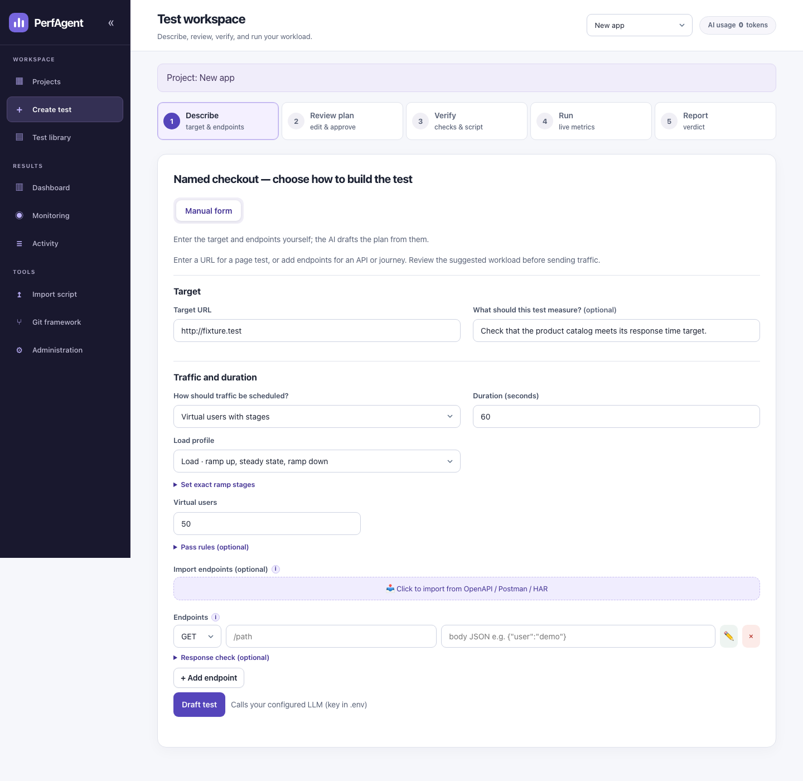
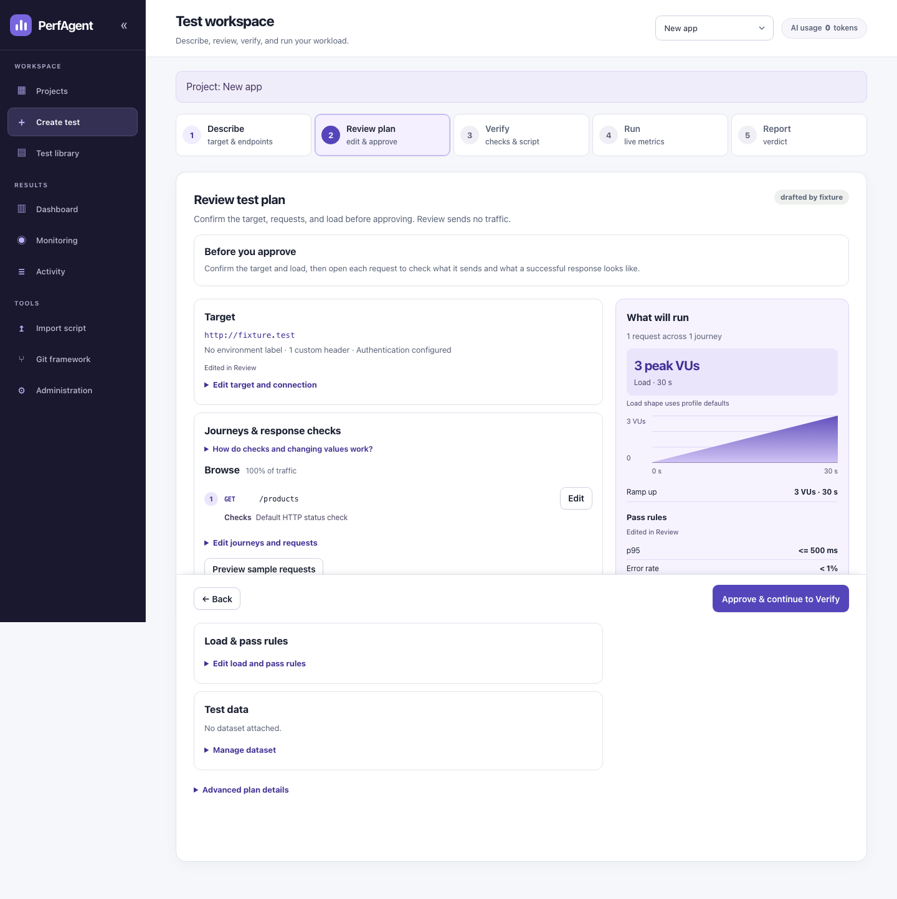
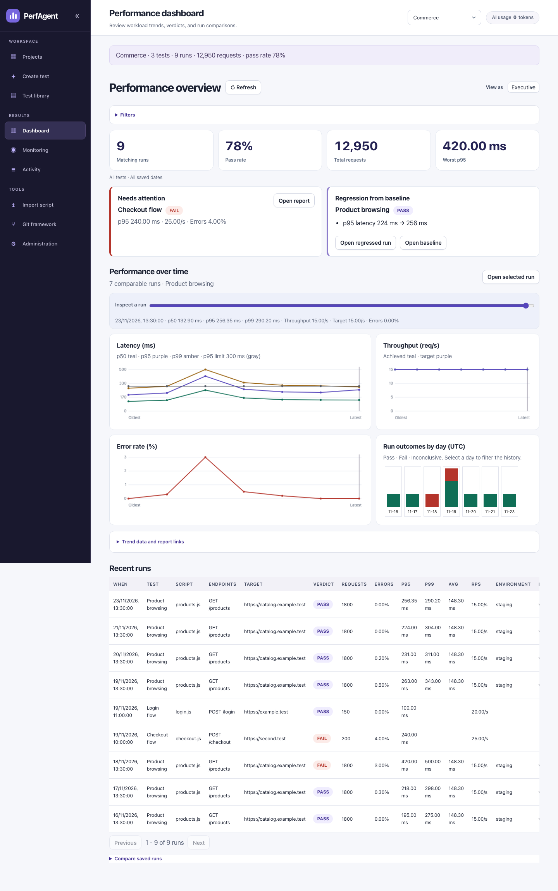
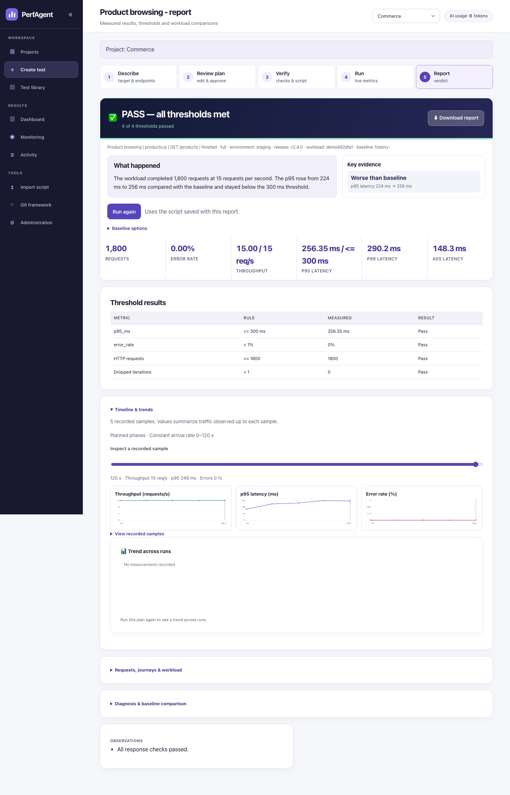

# PerfAgent React workspace

React + TypeScript + Vite frontend for the existing FastAPI application. React Router owns URL navigation and history. The production build is served by FastAPI, so deployment does not require a separate Node server.

## Screenshots

The screenshots show the React workspace with sample data. See the [full screenshot gallery](../README.md#screenshots) for Projects, Project Workspace, Verify, Script History, Run, Monitoring, Activity, and Administration.

| Describe | Review Plan |
|---|---|
| [](../docs/screenshots/describe.png) | [](../docs/screenshots/review-plan.png) |

| Dashboard | Run Report |
|---|---|
| [](../docs/screenshots/dashboard.png) | [](../docs/screenshots/report.png) |

## Technology stack

| Layer | Stack |
|---|---|
| UI and routing | React 19, React DOM, React Router 7, CSS, and Canvas |
| Type checking and build | TypeScript 5.9, Vite 8, Node 22.12+ |
| API integration | Fetch, FastAPI OpenAPI schema, and generated types via openapi-typescript |
| Testing | Vitest for frontend tests and headless Chromium for workflow smoke tests |

## How the UI fits together

- **Projects and Project Workspace** organize saved tests, the configured Git framework, and saved runs.
- **Describe → Review Plan → Verify → Run → Report** takes a test from input to saved evidence. Describe accepts an optional JSON-field existence check per endpoint. Review exposes per-request assertions and dynamic data sources.
- **Script history** shows the latest and previous versions with preview and download actions. Repeated approval reuses an identical latest version.
- **Dashboard** shows workload trends, run outcomes, and compatible baseline regressions. Use the history filters and the chart run selector to open a saved report.
- **Run Report** shows the backend verdict and narrative, linked evidence, the synchronized timeline, endpoint rankings, and export actions.

The browser sends planning and reporting requests to FastAPI. The backend owns the guarded AI provider, execution credentials, script generation, verification, and metrics. See the [system architecture](../README.md#architecture) and [AI roles](../README.md#ai-roles).

## Development

Use Node 22.12 or newer. From `frontend/`:

```text
npm ci
npm run dev
```

Start the Python backend separately from the repository root:

```text
uv run uvicorn perfagent.api.app:app --reload --port 8080
```

Open the local URL printed by Vite, normally `http://127.0.0.1:5173`. `/api` and `/legacy` are proxied to PerfAgent on port **8080**. Port **8000** belongs to the optional sample target, not the PerfAgent API. A sample-target response cannot handle `/api/projects`.

From the repository root, the equivalent frontend command is `npm --prefix frontend run dev`. Follow the [first UI test](../README.md#first-ui-test) to verify the workflow locally.

Set `PERFAGENT_API_URL` in the repository-root `.env` or shell before starting Vite if the backend uses a different port. For example, in PowerShell: `$env:PERFAGENT_API_URL='http://127.0.0.1:9000'`. Restart Vite after changing the proxy target. Application secrets remain in the backend `.env`; never copy them to `VITE_` variables. Vite reads only the backend-address setting from that file.

## Production and checks

```text
npm run build
npm test
```

The build runs TypeScript checking and writes `src/perfagent/web/spa/`. FastAPI serves that build at `/`, supports browser refreshes on SPA routes, and serves assets under `/assets`. The previous workspace remains at `/legacy`. If no build exists, `/` uses the previous workspace rather than returning a blank page.

Built assets are committed so the Python package/checkouts can serve the UI without installing Node. Rebuild after changing frontend source, and commit the matching output. Do not edit the hashed files directly.

Browser regression checks from the repository root:

```text
node tests/ui_smoke.cjs
```

The harness uses real headless Microsoft Edge with fixture API responses; it does not generate target load. Set `PERFAGENT_EDGE_PATH` for another Edge installation. Set `PERFAGENT_UI_MODE=legacy` to run the shared checks against the preserved workspace.

## Source layout

- `src/pages/`: Projects, test workspace, dashboard, library, monitoring, activity and admin pages.
- `src/components/`: shared navigation, header, dialogs and layout.
- `src/routing/`: route resolution and route tests.
- `src/api/`: shared API error handling, typed requests and generated OpenAPI declarations.
- `src/styles/`: shared workspace styles, SPA layout, and responsive results and review views.
- `src/workspace/controller.js`: explicitly transitional compatibility layer for the existing workflow and advanced editor logic.

Regenerate API declarations after backend contract changes:

```text
npm run api:types
```

This imports the local FastAPI app using the repository `.venv`. `PERFAGENT_PYTHON` can point to a different Python executable. The schema is generated locally without a running backend or copying runtime credentials into the frontend.

## Workspace implementation

React owns the production page layouts and routing. The previous single-file workspace remains available at `/legacy`.

Workflow state and dynamically generated editor rows still use the compatibility controller. That module exposes a limited-lifetime window bridge for existing generated-row handlers; it is initialized after React mounts and cleaned up on unmount. Pages stay mounted to preserve active form/editor state while routes change. This is not yet a complete conversion to React-managed form and server state.

New frontend features should use React hooks and `src/api/client.ts`. The next refactor is to move project and dashboard state into hooks, followed by the dynamic scenario editor, so the compatibility bridge can be retired. Keep the previous workspace stable as a fallback during that work.

Account authentication and project membership remain backend deployment concerns; the admin overview continues to use its existing server-side token check.
